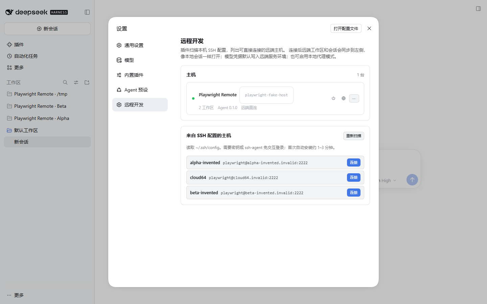

# dsh-waypoint

[](https://github.com/wooyang2018/dsh-waypoint/actions/workflows/ci.yml)
[](https://www.npmjs.com/package/dsh-waypoint)
[](https://awesome-dsh-plugin.com)

English | [Chinese](README.zh.md)

Remote development that behaves like a local session.

Add an SSH host once. The plugin provisions the remote DSH runtime itself, mirrors its workspaces and
sessions into the local sidebar, and opens a remote session in the **ordinary Conversation UI** — the
same transcript, composer, tool cards, stop control, and session list as a local session.



```text
Local DSH                                         Remote host
┌──────────────────────────────────────┐          ┌──────────────────────────────┐
│ normal sidebar + Conversation UI     │          │ dsh web (installed by plugin)│
│  local mirror Session + Agent façade │  SSH     │ dsh-waypoint-agent             │
│  host registry / auto provisioning   │◀────────▶│  workspace/session write     │
│  direct key or local key proxy        │          │  remote tools + model calls  │
│  authenticated /api route            │  tunnel  │                              │
└──────────────────────────────────────┘          └──────────────────────────────┘
```

## Supported environment

This plugin is developed for the **official DSH Desktop application**. Supported DSH versions:

| Component | Version |
|---|---|
| [DSH Desktop / official client](https://github.com/deepseek-ai/deepseek-harness) | [**0.2.2-rc.5**](https://github.com/deepseek-ai/deepseek-harness/releases/tag/dsh-v0.2.2-rc.5) (tested) |
| Plugin | [**1.1.2**](https://www.npmjs.com/package/dsh-waypoint) |
| Remote DSH runtime | [**0.2.2-rc.5**](https://github.com/deepseek-ai/deepseek-harness/releases/tag/dsh-v0.2.2-rc.5) (tested; new installs follow the local DSH version) |
| Remote Node.js | [**22.19+**](https://nodejs.org/en/download) (one-click nvm + latest LTS install from the host card) |
| Remote OS | Linux or macOS |

Other DSH GUI plugins, community forks, modified clients, non-DSH GUIs, and other DSH versions have
**not** been tested. The package's dependency range is intentionally permissive for installation, but
it is not a compatibility or support guarantee. The desktop client and the remote runtime are tested
on `0.2.2-rc.5`; new remote installs follow the local DSH runtime version by default and can be
pinned with `remoteDshVersion`.

## What works now

Everything below works against a real SSH host, with no client fork:

- One-click local plugin install (`scripts/dev/install-local.mjs`)
- Plugin-owned remote provisioning over SSH
- Host registry, discovery, SSH tunnel, health, reconnect
- Remote workspaces appear as normal local workspaces
- Remote sessions appear in the normal sidebar, and open in the normal Conversation UI
- Localized UI follows the DSH language (zh / en)
- Prompts, stop, transcripts, tool cards, usage
- Per-host model key source (local proxy or remote direct)
- Remote model catalog, offered in the model menu for mirrored Sessions
- Restart the remote DSH without reinstalling (`systemd` deployments; `nohup` uses Reinstall)
- Open the remote DSH Web UI through the tunnel
- Remote file tree and file previews, agent-backed over the SSH tunnel
- Remote workspace search from the native file panel, by name or workspace-relative path
- Remote terminal per Session — local Sessions keep the local PTY, remote Sessions use the remote
  agent's PTY over the SSH tunnel
- Remote dev servers in the right-sidebar browser, through loopback port forwards (see below)
- Agent tools for host/workspace/session operations
- Approval prompts bridged into the local UI

What is **not** supported — Windows remotes, relay/NAT traversal — is listed under
[Known limits](#known-limits), together with the workaround when there is one.

> Remote file and terminal operations require the agent-backed API. If the connected remote agent is older, file/terminal actions fail with a Reinstall instruction instead of opening extra SSH connections.

## Install

### From the DSH plugin page

Open **Plugins → Add plugin** and enter:

```text
dsh-waypoint
```

The package is published on [npm](https://www.npmjs.com/package/dsh-waypoint); DSH installs the bundle from the registry. The package includes the remote agent asset, so there is nothing else to install. Restart DSH when the plugin page asks
for it; **Settings → Remote development** then appears.

If npmjs.com still resolves an older `latest` tag for a newly published release, install the exact
current version instead:

```text
dsh-waypoint@1.1.3
```

Keep this pinned version in sync with each release.

### From a source checkout

For development, clone the repository and run the installer:

```sh
cd /path/to/dsh-waypoint
pnpm install
pnpm -r build
node scripts/dev/install-local.mjs
```

The script builds the workspace, creates a single plugin tarball, and installs it — into the `desktop`
profile by default:

```sh
node scripts/dev/install-local.mjs              # desktop profile
node scripts/dev/install-local.mjs --profile web
```

The `desktop` profile refuses `dsh plugin` at argument parse time, so the script installs through the
CLI's own exported `runCli` with the in-process permission that check looks for. That is the same code
path the running Host uses, including the bundle registration step, so nothing is reimplemented and the
profile lock still serializes the write. Because only the application's runtime can read inside
`app.asar`, the script re-executes itself under it when started with plain Node.

A running DSH holds plugin files open and pnpm replaces packages by renaming directories, so quit the
app before installing, then reopen it to load the new bundles. **Settings → Remote development**
appears.

## Use

1. In **Settings → Remote development**, enter the SSH target (`my-host`) and click **Save and connect**.
2. On first use the plugin discovers or installs the remote agent, starts remote `dsh web`, and opens
   the loopback tunnel. It also applies a model key source: with the default seed it copies the
   resolved model key into the remote environment. The card shows **Installing → Connected** and the
   row reads **Remote direct**; switch **Model key source** to **Local key proxy** on the card if you
   would rather keep the key here.
3. In the sidebar **Workspaces** header, click **+**. The create dialog chooses **This computer** or a
   connected **Remote device**, then **Add** a source folder. Local folders use the native system
   directory picker; remote folders use the read-only SSH browser.
4. The create flow opens a remote Session, creates a local mirror, and **opens it in the ordinary
   Conversation UI**. The workspace row's **New session** action uses the same remote path.
5. Type in the usual composer. The remote DSH runs the turn; the local transcript updates live. Tool
   calls, usage, stop, and multi-turn follow-ups behave like a local session.
6. The **Workspace files** and **New terminal** panels follow the selected Session: local Sessions
   use the local machine, remote mirror Sessions use the remote workspace.

The Settings page is now only host/workspace management. The conversation is not a popup.

## Removing a local remote workspace

Removing a mirrored workspace from the local sidebar pauses its local synchronization. The remote
workspace, files, running sessions, and local cached history are retained. Catalog refreshes,
reconnection, and plugin restarts do not add the row back.

To resume, use **Add workspace**, select the same remote device and directory, and add it again.
The plugin restores the existing local history and catches up from the remote log (within the
configured snapshot window). Creating a session from a removed workspace requires this explicit
add first; discovering it in the remote catalog alone does not resume synchronization.

## Test/CI workspace visibility

Test isolation is controlled by a test-only manifest in the test DSH home, not by the Settings UI or
an agent tool:

```text
$DSH_HOME/waypoint/test-visibility.json
```

```json
{"hiddenPaths": ["/tmp/dsh-waypoint-tests"], "hiddenWorkspaceIds": ["remote-workspace-id"]}
```

`hiddenPaths` prevents local registration at creation. `hiddenWorkspaceIds` hides an existing visible
test workspace after the run; local mirror sessions are archived, not deleted, and are restored when
the entry is removed. See [docs/testing.md](docs/testing.md).

## Development and testing

Agent-facing testing instructions live in [AGENTS.md](AGENTS.md). For UI/integration work use the
isolated environment:

```sh
node scripts/test/test-sandbox.mjs
```

See [docs/testing.md](docs/testing.md) for test workspace visibility.

## How the native session works

The plugin does not embed a second chat UI and does not iframe the remote page. It:

1. creates a real local `Session` seeded from the remote session's committed event log;
2. registers a small custom Agent façade for that local session;
3. routes `followup`/`steer`/`cancel` from the local Agent façade to the remote agent API;
4. follows the remote log and appends new committed events to the local Session;
5. lets DSH's existing Session Controller, sidebar, Conversation assembler, composer, and tool renderers
   display it exactly like a local session.

The remote DSH remains the execution owner. The local Session is a durable, live mirror, so the
ordinary client code paths handle rendering, selection, streaming, and the transcript.

## Model credentials

**The choice is per host.** Each host card has a **Model key source** switch with two values
(**Local key proxy** / **Remote direct**), and the collapsed row states the live result as
**Local proxy**, **Remote direct**, or **Remote default**:

- **Local key proxy** — keeps the key on this machine. The remote DSH gets
  `DEEPSEEK_BASE_URL=http://127.0.0.1:47821` and a placeholder key; the SSH tunnel adds
  `-R 127.0.0.1:47821:127.0.0.1:<local-proxy-port>`; the local proxy injects the real key and forwards
  to `credentialProxyUpstream`.
- **Remote direct** — the resolved local key is copied into the remote `dsh web` environment (the
  systemd unit or the `nohup` environment) with
  `DEEPSEEK_BASE_URL=https://api.deepseek.com/anthropic`. The remote host calls DeepSeek directly.

Switching a host's source restarts its remote DSH. The profile-wide `credentialProxy` setting is only
the seed for hosts that never chose: `false` seeds `remote direct`, `true` seeds `local key proxy`. A
host that has chosen keeps its choice.

If no local key resolves, the plugin still provisions and connects; configure the remote DSH's own
credentials. The row then reads **Remote default**, meaning the plugin supplied no key and the remote
host uses its own.

## Agent tools

| Tool | Purpose |
|---|---|
| `remote_hosts_list` | Hosts, phases, remote facts |
| `remote_host_add` | Add an SSH host and start provisioning |
| `remote_host_connect` | Connect/reconnect/refresh |
| `remote_host_provision` | Force reinstall/restart and reconnect |
| `remote_host_restart` | Restart the remote DSH service without reinstalling |
| `remote_workspace_add` | Register a remote directory |
| `remote_workspaces_list` | List remote workspaces |
| `remote_session_create` | Create a remote session |
| `remote_sessions_list` | List remote sessions |
| `remote_session_prompt` | Send a prompt |
| `remote_session_snapshot` | Read a transcript page |
| `remote_session_cancel` | Cancel the active turn |

`remote_host_add`, `remote_host_connect`, `remote_host_provision`, and `remote_host_restart` ask for
approval before they run: they may open an SSH connection, and in direct-key mode provisioning copies
the local model key into the remote service environment. `remote_host_restart` requires the
installer-owned systemd user unit; a `nohup` deployment uses **Reinstall** or a manual restart instead.

There is deliberately no tool for publishing a port. A forward only makes sense for the machine
holding the SSH connection, which is the one drawing the browser, so it is initiated by a click rather
than by an agent (see below).

### Previewing a remote dev server

The right-sidebar browser renders pages on **your** machine, so `http://localhost:5173` typed into it
looks for a server here, not on the remote host. In a Session mirrored from a remote host, **clicking a
loopback address in the transcript** is all it takes: the plugin publishes that port on local loopback
and opens the page in the Browser tab beside the conversation.

Recognized addresses are `127.0.0.1`, `localhost`, `[::1]`, and `0.0.0.0`, with an explicit port, as
`http://…` or as a bare `localhost:5173`. A link to a non-loopback host is left alone — the remote end
of every forward is the literal `127.0.0.1`, so a `192.168.x.x` address cannot be served.

The same port number is preferred, so a dev server's own absolute links keep working. When that number
is already taken here, an ephemeral port is used and the host's row in Settings warns that absolute URLs
naming the original port will break — serve relative paths or set the dev server's base/origin. HMR
works because the forward carries raw TCP, WebSocket included.

Published ports live in memory only. They survive neither a DSH restart nor a host reconnect, and they
do not accumulate rows you have to clean up: the next click republishes. The host's expanded row in
Settings lists what is currently published, which is also where a refused bind explains itself.

## Requirements

**Local:** official [DSH Desktop](https://github.com/deepseek-ai/deepseek-harness) or DSH Web with the same core version, plus `ssh` with key or ssh-agent auth. Only the official Desktop client is a verified GUI target.

**Remote:** Linux or macOS with an SSH server. [Node.js 22.19+](https://nodejs.org/en/download) is
discovered through the account's own shell, so PATH, nvm, Volta, fnm, Bun, asdf, mise, Nix, and
Homebrew all answer. Provisioning does **not** install a runtime on its own: picking a version is your
decision, and a second one on the machine is how two runtimes end up fighting over one command. A
missing or too-old Node.js stops the install with a message naming what it found. When you want the
plugin to do it, the host's `⋯` menu offers **install remote Node.js**: one click, which checks the
host first, installs nvm and the latest LTS (`nvm install --lts`) only if it is needed, never touches
a shell startup file, and reports the outcome as a line on the card. Windows remotes are not
supported.

The remote terminal uses a Python helper (`pty` from the standard library) instead of a native
`node-pty` build, so **New terminal** needs `python3` on the remote host. Nothing else does: installing,
connecting, sessions, prompts, files, and the transcript all work without it, and only **New terminal**
fails — the terminal panel opens and reports the PTY failure. `python3` ships with mainstream Linux
distributions and macOS; a minimal container image is the usual place it is missing.

`pnpm` and `@deepseek-ai/dsh` are installed **globally**, into the prefix `npm prefix -g` reports, so the
`dsh` the plugin starts and the `dsh` you type yourself are the same file and the same version. Override the
prefix with `remoteGlobalPrefix` when npm's answer is not the one you want; there is no fallback location,
because a silently relocated `dsh` is exactly the divergence this removes. If that prefix is not on your
login shell's `PATH`, the install log prints the one `export PATH=…` line to add — the installer never edits
your shell startup files. A prefix npm cannot write fails the install with npm's own error instead of
installing somewhere else; note that npm writes
`<prefix>/lib/node_modules` and `<prefix>/bin`, so a machine can have one writable and not the other, which
is what `dsh-waypoint-install doctor` is for.

If the remote host needs a proxy, set `remoteInstallProxy` to a URL that is reachable **from the
remote host**, for example `http://127.0.0.1:17890` when a port forward serves the proxy there. The
installer exports `HTTP_PROXY`, `HTTPS_PROXY`, `ALL_PROXY`, and `npm_config_*` for the bootstrap.
When the option is empty, it uses the account's actual login shell (bash, zsh, fish, and other common shells) and its login/interactive startup files to read `HTTPS_PROXY`/`HTTP_PROXY`.
The same proxy is written into the remote systemd unit (or inherited by the `nohup` process), so
remote model requests use it as well, not just the installer.

## Security

- SSH is the transport; tunnels bind `127.0.0.1` only.
- Host keys default to TOFU (`accept-new`); use `yes` with a prepared `known_hosts` for strict checks.
- The remote agent is loopback-only and bearer-authenticated. Its execution surface is terminal
  allocation/input plus workspace/session create, prompt, and cancel; file reads are read-only.
  Prompts can make the remote DSH use its own tools under the remote sandbox and approval policy.
- In the default direct mode, the resolved model key is written to the remote systemd/nohup
  environment. Use this only on a trusted remote account; the systemd unit is written with mode 0600.
  Set `credentialProxy: true` to keep the key local and proxy model traffic through the reverse SSH
  tunnel. Proxy requests require a per-host token, so unrelated local users on the remote host cannot
  reuse the tunneled credential endpoint.
- Browser requests use DSH Connection's authenticated `/api` Fetch route. Tokens/credentials are stored
  in `0600` files and never returned to the browser.
- File-tree, preview, directory-picker, and terminal traffic use the remote agent API inside the authenticated SSH tunnel; no additional SSH connection is opened per file or terminal operation.
- Only connect trusted remote accounts; the remote DSH has that account's privileges.

## Configuration

```yaml
- id: dsh-waypoint
  config:
    autoProvision: true
    remoteDshHome: ~/.dsh
    # npm globals (pnpm and @deepseek-ai/dsh) go into this prefix; empty asks `npm prefix -g`.
    remoteGlobalPrefix: ''
    # remoteDshVersion: 0.2.2-rc.5  # pin a remote DSH version; omit to follow the local DSH version
    remotePnpmVersion: 11.21.0
    # Remote-visible proxy for npm and DSH downloads. Empty means inspect the remote login shell.
    remoteInstallProxy: ''
    remoteInstallNoProxy: 127.0.0.1,localhost
    remoteStart: systemd          # systemd | nohup | none
    # Direct key mode (default): copy the resolved key to the remote service env.
    credentialProxy: false
    copyModelKey: true
    remoteModelBaseUrl: https://api.deepseek.com/anthropic

    # Optional proxy mode: keep the key local.
    credentialProxyUpstream: https://api.deepseek.com/anthropic
    credentialProxyRemotePort: 47821
    modelCredentialRef: DEEPSEEK_API_KEY

    # Mirror remote work into the ordinary local UI.
    mirrorSessions: true
    mirrorPollMs: 1500
    mirrorMaxEvents: 2000

    # Master switch for click-to-forward of dev-server ports. `false` makes a
    # loopback link in a mirrored Session navigate normally instead.
    portForwarding: true
```

The remote agent config remains available for advanced deployments:

```yaml
- id: dsh-waypoint-agent
  config:
    stateFile: ''
    token: ''
    loopbackOnly: true
    defaultSnapshotEvents: 500
    maxSnapshotEvents: 2000
    heartbeatMs: 15000
```

## Known limits

- The complete remote DSH browser UI is a diagnostic surface, not the primary flow. The remote agent
  keeps `dsh-api-remotes` enabled so that surface keeps booting, and its approval bridge registers
  with `prepend` so mirrored approvals still reach the native local UI; use the host card's
  **Open remote Web UI** action when you need the remote browser (for example to install remote
  plugins).
- The local workspace anchor is a metadata handle. File listing, preview, and terminal are routed to
  the remote workspace; remote diffs and some advanced file actions still use the native session's
  own tool results.
- The native **Workspace files** panel browses a remote workspace with no third-party sidebar plugin:
  the plugin replaces the Host's `workspaceFiles` service methods, so the panel's listings, previews,
  searches and change watches are served by the remote agent over the tunnel. A DSH release that
  renames one of those methods turns that routing off; Settings → Remote development then reports
  that file routing is bypassed instead of showing an unexplained empty tree.
- A remote session longer than `mirrorMaxEvents` is mirrored from the first complete turn in the
  available tail; older history stays in the remote session. Increase the limit to mirror further
  back, or open the session on the remote host to read the rest.
- An attachment sent from a mirrored session crosses the tunnel inline and is capped at about 9 MB per
  file (a 12 MiB prompt body minus base64 overhead). Larger files need to be placed in the remote
  workspace and referenced by path. Attachments a remote user sends are copied into the local
  attachment store when the mirror replays them, so the first open of a long history fetches them
  once; if the remote object has since been pruned, a file card still shows its name and size while
  an image renders as a placeholder.
- A forwarded dev-server port is published at `http://127.0.0.1:<port>/`; the sidebar browser's
  iframe policy (`X-Frame-Options`, mixed content) still applies, so a host that refuses to be
  embedded needs its own header change or the **Open in system browser** action. When the local port
  differs from the remote one, pages whose absolute URLs name the remote port will not resolve.
- Windows remotes and relay/NAT traversal are not supported.

## Troubleshooting

| Symptom | Action |
|---|---|
| **Installing** never finishes / `Waiting for remote dsh web…` | Check `ssh -o BatchMode=yes my-host true`. Provisioning detects Node.js through your shell (nvm/Volta/fnm) and never installs one itself, so a missing or too-old Node.js ends the install with an explicit message. Use `⋯` → **install remote Node.js** (nvm + latest LTS), or install [Node.js 22.19+](https://nodejs.org/en/download) there, then **Reinstall** |
| Install stops saying Node.js was not found, and the card stops retrying | That failure is permanent, so automatic reconnects stop instead of looping. Use `⋯` → **install remote Node.js** (probes first, then nvm + latest LTS without touching shell files), then **Reinstall** — or install Node.js 22.19+ yourself under an interactive shell for that account, confirm `bash -lic 'command -v node'` prints a path, and reinstall |
| `does not accept POST` | Remote agent is old; click **Reinstall** |
| No remote workspace in sidebar | Use **Workspaces +**, or Settings → Remote development → Workspaces |
| Native session has no reply | Check the host row's **Local proxy / Remote direct / Remote default** state; configure remote credentials or switch to the local key proxy |
| `DeepSeek Messages request failed (404)` | Proxy upstream must be `https://api.deepseek.com/anthropic`; the fixed proxy joins/preserves the provider prefix. Reinstall the local plugin and reconnect |
| Approval appears locally but remote tool still fails | The local decision was sent; check the remote tool result |
| Local terminal opens local shell | Expected for local Sessions; remote Sessions use `Remote · <dir>` terminals |
| Remote terminal opens local zsh | The stock terminal-controller row is disabled by another patch, so no terminal service is provided; remove that disable |
| Port changed after remote restart | The tunnel drops and the plugin reconnects, which re-runs discovery; **Restart remote DSH** or **Reinstall remote agent** does it on demand |
| Install fails while reporting the npm global prefix | npm cannot write `<prefix>/lib/node_modules` or `<prefix>/bin` for this account, or `npm prefix -g` printed nothing. Point `remoteGlobalPrefix` at a directory you own (for example `~/npm-global`) and retry |
| `dsh` not found in your own shell after installing | The install log printed the `export PATH=…` line to add to your shell startup. The installer does not edit those files itself |
| Remote DSH stopped starting after you switched Node.js versions | An nvm/Volta switch moves the npm global prefix with it, so the service's baked-in `dsh` path no longer exists. Click **Reinstall**; `dsh-waypoint-install doctor --target …` reports `global_dsh` and `login_path_has_dsh` |
| Remote agent port jumps around or the host keeps disconnecting | Two `dsh web` processes are writing the same `agent.json`. Run one per `DSH_HOME`; `doctor` reports `dsh_web_processes` |
| A published port says `error: local port N is already in use` | Something else on this machine holds that number. Clear the **Local port** field to let the plugin pick another one, or stop the other process |
| The forwarded page loads but its assets 404 | The local port differs from the remote one, so absolute URLs naming the remote port do not resolve. Serve relative paths or set the dev server's base/origin, or free the remote number locally and click the link again |

Remote logs: `journalctl --user -u dsh-waypoint-agent -f` or `$DSH_HOME/waypoint-agent/web.log`.

## Verify

```sh
pnpm verify
```

The suite covers protocol/SSE/cursor/write contracts, installer rendering, proxy forwarding, and the
client bundle. The native path was validated against a real Linux remote host: plugin provisioning,
remote workspace/session creation, a remote prompt through the local key proxy, live event mirroring
into the ordinary Conversation UI, a second follow-up, and a remote tool call/result.

## Relationship to upstream

`dsh-waypoint` started as a fork of [Golden-Pigeon/dsh-remote](https://github.com/Golden-Pigeon/dsh-remote).
The changes below were offered back upstream, the offer was declined, and the work continues here as
an independent project under its own name. Both are MIT licensed, the original authors keep their
attribution in [LICENSE](LICENSE) and [THIRD_PARTY_NOTICES.md](THIRD_PARTY_NOTICES.md), and the
repository history — including every upstream commit — is preserved unchanged.

Because the rename also changes the identity DSH persists, the two are **separate installs** and
neither reads the other's state:

| | Upstream `dsh-remote` | This project |
|---|---|---|
| Bundle | `dsh-remote-local-plugin` | `dsh-waypoint` |
| Remote agent | `@goldenpigeon/dsh-remote-agent` | `dsh-waypoint-agent` |
| Host registry | `$DSH_HOME/remote` | `$DSH_HOME/waypoint` |
| Agent state (remote) | `$DSH_HOME/remote-agent` | `$DSH_HOME/waypoint-agent` |

Nothing is migrated automatically. If you are switching over, remove the old bundle
(`dsh plugin --profile <p> remove dsh-remote-local-plugin`) so two Settings sections cannot appear,
then follow `docs/operations.md` for moving the host registry and cleaning up the old
`dsh-remote-agent.service` on the remote host.

## Documentation

- [Wire protocol](docs/protocol.md)
- [Remote workspace mechanism](docs/remote-workspace-mechanism.md) — how a remote directory becomes a
  local workspace: discovery, tunnel, the session mirror, files/terminal routing
  ([中文版](docs/remote-workspace-mechanism.zh.md))
- [Host routing for mirrored paths](docs/mirror-host-resolution.md) — why a remote path does not name
  a host, how ambiguity is refused instead of guessed, and what `spawn git ENOENT` actually means
- [Operations guide](docs/operations.md)
- [Development](docs/development.md)
- [Testing](docs/testing.md)
- [Adapting to a new DSH release](docs/adapting-to-dsh-releases.md)
- [Releasing](RELEASING.md)
- [Security policy](SECURITY.md)
- [Contributing](CONTRIBUTING.md)
- [Changelog](CHANGELOG.md)
- [Third-party notices](THIRD_PARTY_NOTICES.md)

## Packages

| Package | Role |
|---|---|
| [`@dsh-waypoint/protocol`](packages/protocol) | Wire types, surface metadata, cursor, SSE, typed client |
| [`dsh-waypoint`](packages/local-plugin) | Provisioning, tunnel, proxy, **native session mirror**, tools, Settings |
| [`dsh-waypoint-agent`](packages/remote-agent) | Remote host plugin for workspaces, sessions, prompts, SSE |
| [`@dsh-waypoint/installer`](packages/installer) | Bootstrap library/CLI used by the plugin |
| [`@dsh-waypoint/testkit`](packages/testkit) | Fake host and wire contract tests |

## License

MIT. See [LICENSE](LICENSE).

[](https://github.com/deepseek-ai/deepseek-harness)
