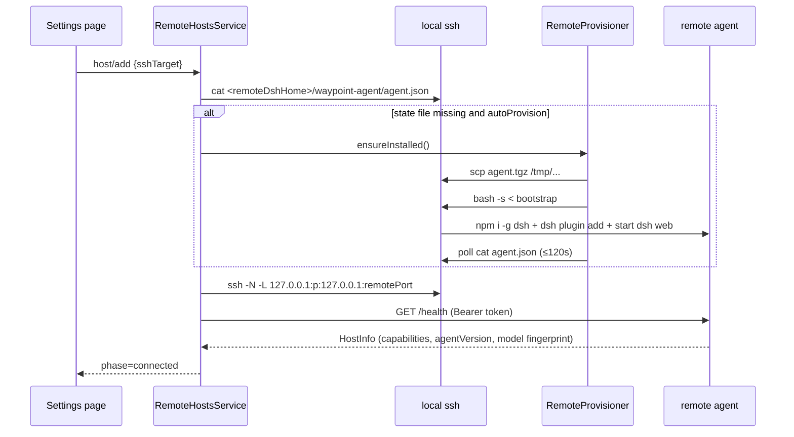

# How a remote workspace opens: one connection, one mirror, one tunnel

This page explains how `dsh-waypoint` turns "a directory on another machine" into "a workspace in the
local sidebar" at runtime, and why clicking it opens the **ordinary conversation UI** instead of an
iframe or a second chat window. It is written for someone reading this repository for the first time
who needs to find the place to change or to judge the boundaries. Per-field protocol definitions live
in [protocol.md](protocol.md) and operator actions in [operations.md](operations.md); this page does
not repeat either.

Source locations are cited as `file → symbol` rather than line numbers: line numbers drift with every
refactor while symbol names stay searchable. The behaviour described corresponds to plugin `1.0.1`.

## 1. The mechanism in one sentence, and the traps it avoids

Four things live in the local DSH process at once: a **host registry**, an **SSH tunnel**, a **local
session mirror**, and a **custom Agent façade** mounted on the mirrored session. The remote side runs a
complete `dsh web` plus an HTTP/SSE interface provided by the `dsh-waypoint-agent` plugin. The sidebar
shows a local session; execution happens remotely.

```text
local DSH process                                    remote host
┌───────────────────────────────────────┐          ┌──────────────────────────────┐
│ workspaceRegistry.create(anchor)      │          │ dsh web (127.0.0.1:random)   │
│ sessions.create(seed=remote event log)│  ssh -L  │  └ dsh-waypoint-agent routes │
│ agents.enter(RemoteMirrorAgent)       │◀────────▶│     /dsh-waypoint-agent/api/v1│
│ HostsApi ── /api/dsh-waypoint ──┐     │          │                              │
│                                 ▼     │  ssh -R  │ workspaces/sessions/PTY/files│
│ RemoteHostsService ── RemoteAgentClient ─────────▶│ model calls (direct or proxy)│
└───────────────────────────────────────┘          └──────────────────────────────┘
```

The point is that there is **no second UI and no second agent loop**. The remote DSH stays the owner of
execution; the local session is only a durable projection of the remote's committed event log (the
module comment in `packages/local-plugin/src/mirror/service.ts` states this as a design constraint).
The direct payoff: the sidebar, session assembler, composer, tool cards, and stop button all reuse
existing code paths, and the plugin only replaces three seams — where a session comes from, where a
prompt goes, and where events are read from.

The cost sits in the same place: the mirror has to maintain its own "remote seq ↔ local seq" mapping,
and any gap it cannot bridge stops the mirror from following (see §5.5).

## 2. What each of the five packages owns

| Package | Runtime role | Entry point |
|---|---|---|
| `packages/local-plugin` | Host registry, tunnel, credential paths, mirror service, `/api` routes, Settings page, tools | `apply` in `src/index.ts` |
| `packages/remote-agent` | DSH plugin installed into the remote `web` profile; registers loopback HTTP/SSE routes | `apply` in `packages/remote-agent/src/index.ts` |
| `packages/protocol` | Route table, envelope validation, SSE parsing, typed client | `RemoteAgentClient` in `src/client.ts` |
| `packages/installer` | Renders and runs the remote bootstrap script (scp + `bash -s`) | `provisionRemoteAgent` in `src/provision.ts` |

The local plugin's `apply` mounts everything in dependency order: it builds `RemoteHostsService` (hosts)
and `RemoteMirrorService` (mirror), then `mirrors.start()` → `service.start()` → `mirrors.sync()`, and
only after that registers the `/api` routes, the file adapter, the terminal routes, and the tools
(`apply` in `src/index.ts`). The order is deliberate: the mirror must own its relationships before the
first host-store read or connection await, otherwise the replay at startup would treat remote sessions
as ordinary sessions.

## 3. The first connection: from an SSH destination to `connected`

### 3.1 Sequence



### 3.2 Discovery: read exactly one file

The first step of a connection is not the tunnel but endpoint discovery. `discoverAgent` runs one
**fixed** `cat` command through `execFile` to read the remote private state file, then validates its
shape with `isAgentDiscoveryState` / `isAgentLive` (`discoverAgent` in
`packages/local-plugin/src/ssh/probe.ts`). The command itself is assembled by `discoveryCommand`, and
the path comes only from plugin configuration and is quote-escaped (`discoveryCommand` in the same
file) — neither SSH-config scanning nor the state-file read ever splices user input into shell syntax.

```ts
export async function discoverAgent(target, options): Promise<DiscoveryResult> {
  // ...
  if (!isAgentDiscoveryState(parsed)) throw new LocalError('agent/unavailable', 'remote agent state file has an unexpected shape', ...)
  if (!isAgentLive(parsed)) throw new LocalError('agent/unavailable',
    'remote agent is installed but its DSH web listener is not running; start `dsh web` on the remote host', ...)
}
```

The remote agent writes the state file itself: `#bindListener` takes the real port from
`ctx.webServer.port` and then writes a `0600` file atomically (`#bindListener` in
`packages/remote-agent/src/service.ts`, `writeState` in `src/state.ts`). **The agent does not listen on
a TCP port of its own**; it registers its routes on the remote DSH web server (`registerAgentRoutes` in
`src/http.ts`), so the `port` in `agent.json` is the port of that `dsh web`. The plugin side's
`remoteStart: systemd` unit passes `--port 0` and lets the OS choose (the default in
`packages/installer/src/options.ts`), so the port can change on every restart — which is why the state
file has to record it and why the plugin has to rediscover on every connection.

### 3.3 When it cannot install, it says so: the bootstrap boundary

`RemoteProvisioner.ensureInstalled` uploads the bundled `dsh-waypoint-agent-*.tgz` to `/tmp` and then
runs the rendered bash script through stdin (`provisionRemoteAgent` in
`packages/installer/src/provision.ts`). The script does four things: resolve the account's real shell to
find Node.js, install `pnpm` and `@deepseek-ai/dsh` into the npm global prefix, `dsh plugin --profile
web add` that tarball, and finally start `dsh web` (`renderBootstrapScript` in
`packages/installer/src/bootstrap.ts`).

Two deliberate "we do not" decisions explain the design better than the "we do" list:

- **We do not install a runtime.** Version managers (nvm/fnm/Volta) only take effect in login or
  interactive shells, so the `node` a non-interactive SSH command sees can be entirely different. So
  `nodePathPrelude` asks the account's own shell first (`-lic`, falling back to `-lc`) and puts the
  result at the front of `PATH` (`nodePathPrelude` in the same file); when nothing is found it fails
  with `exit 21` / `exit 22` plus the evidence, and the **install remote Node.js** entry in the host's
  `⋯` menu owns that decision. That entry probes first and only installs what the probe says is
  missing, then reports the outcome as a status line on the card — the same shape as **reinstall
  remote agent**.
- **We do not relocate the install.** The global prefix is either the configured value or whatever
  `npm prefix -g` answers; there is no third candidate (`globalPrefixPrelude` in the same file). If it
  is not writable the install fails with npm's own error instead of quietly installing somewhere else.

Failures split by recoverability: transient ones go to exponential-backoff reconnect, while reasons
that would produce the same result on a retry — `install/node-missing`, `install/node-outdated`,
`install/npm-missing`, `install/profile-migrate-failed` — are recorded as permanent, stop automatic
retries, and keep the original error (`PERMANENT_INSTALL_CODES` in
`packages/local-plugin/src/remote/provisioner.ts`, the failure branch of `#doConnect` in
`src/service.ts`).

### 3.4 The tunnel: two `-L`/`-R` forwards decide the traffic direction

The tunnel is just an `ssh -N` child process bound to an ephemeral port on `127.0.0.1`, forwarding to
the remote agent port:

```ts
return [
  ...baseSshArgs(...),                 // BatchMode, ConnectTimeout, StrictHostKeyChecking, keepalive
  '-N',
  '-o', 'ExitOnForwardFailure=yes',
  '-L', `127.0.0.1:${localPort}:127.0.0.1:${options.remotePort}`,
  ...options.reverseForward === undefined ? [] : [
    '-R', `127.0.0.1:${options.reverseForward.remotePort}:127.0.0.1:${options.reverseForward.localPort}`,
  ],
  options.target.destination,
]
```

(`tunnelArgs` in `packages/local-plugin/src/ssh/tunnel.ts`)

`-L` is the read path: hitting `http://127.0.0.1:<localPort>` from the local `RemoteAgentClient` is
hitting the remote agent. `-R` appears only in local-key-proxy mode (§7). `Tunnel.start` first asks the
system for a free loopback port, then waits until it can actually connect, and additionally checks once
more that the child process is still alive — a port that accepts but whose `ssh` exited immediately is
the most common shape of a false "ready" (`Tunnel.start` in `src/ssh/tunnel.ts`).

Once the tunnel is up, `#doConnect` finishes with a health check and then does two things that only
matter after connecting:

- `#reconcileAgentVersion`: if the remote agent version is **not equal** to the version this build
  bundles (not "older"), reinstall once. The comment explains why: a bundle can change behaviour
  without changing its version, and the "a bit older is fine" assumption is exactly what keeps a stale
  `cordis.patch.yml` in effect (`#reconcileAgentVersion` in `src/service.ts`).
- `#reconcileModelEnvironment`: compares the remote-reported `modelBaseUrl` and the sha256 fingerprint
  of `DEEPSEEK_API_KEY` against the expected values and reinstalls once on a mismatch
  (`#reconcileModelEnvironment` in `src/service.ts`). The remote only returns the fingerprint, never
  the key itself (`hostInfo` in `packages/remote-agent/src/service.ts`).

Both are limited to once per connection cycle by `#agentReconciled` / `#modelReconciled`, so a health
check heartbeat cannot turn the reconciliation into a reinstall loop.

## 4. Workspaces: a local anchor plus a registry record

A remote workspace is not "synced" to local disk. The plugin registers an **empty local directory** as
an anchor and remembers which remote path it stands for:

```ts
const anchor = join(this.#config.stateDir, 'anchors', safe(host.id), safe(remote.workspaceId))
await mkdir(anchor, { recursive: true })
const title = `${host.label} · ${remote.title}`
const workspace = await this.#workspaceRegistry.create(anchor, title)
this.#state.workspaces[ref] = {
  hostId: host.id, remoteWorkspaceId: remote.workspaceId, localWorkspaceId: String(workspace.id),
  anchor, remoteRoot: remote.path, title, updatedAt: new Date().toISOString(),
}
```

(`#ensureWorkspace` in `packages/local-plugin/src/mirror/service.ts`)

That is the whole magic behind "a remote workspace behaves like a local one in the sidebar":
`workspaceRegistry.create` is native, the title carries a `<host> · <title>` prefix so rows stay
distinguishable, and `mirrors.json` stores `remoteRoot` alongside. The anchor has two consequences,
both important:

1. **It is empty locally.** Any code that reads the anchor with plain `fs` sees an empty directory, so
   the file tree, previews, git, and similar paths have to be intercepted explicitly (§6). The README's
   "Known limits" calls the anchor a metadata handle for exactly this reason.
2. **It is also the mirrored session's `cwd`.** A local session needs a path, and relative paths in
   tool cards are aligned against it; a remote absolute path is mapped back to `hostId + remoteRoot`
   through `remoteFileContext` (`remoteFileContext` in `src/mirror/service.ts`).

`sync()` runs every `max(5s, mirrorPollMs×4)` and calls `#syncHost` for each `connected` host: list the
remote workspaces and `#ensureWorkspace` them, then list the remote sessions and `#ensureMirror` them
(`sync` and `#syncHost` in `service.ts`). Creation is check-then-act across several awaits, so it is
coalesced per `hostId:remoteSessionId` with a single-flight table — otherwise the periodic sync and an
on-demand creation would each build their own local session (`#ensureMirror`, `singleFlight` in
`src/mirror/inflight.ts`).

Workspace identity is the `(hostId, remoteWorkspaceId)` pair; subagent sessions and sessions with no
workspace fall back to the parent session's anchor and to `ungrouped:<cwd hash>` respectively
(`#ensureUngroupedWorkspace`).

## 5. Sessions: projecting the remote event log into a local session

### 5.1 Three "new session" entries, two origins

| Entry | Path taken |
|---|---|
| Workspace row's `+` / global New Session (mirrored workspace) | `client/routing.ts` intercepts → `host/session/blank` → empty local session + lazy Agent |
| Workspace creation dialog | `client/workspace-add.ts` → `host/workspace/create` → wait for the local mirror → `host/session/blank` |
| Session that already exists remotely | `sync()` discovers it → `#ensureMirror` builds the mapping directly |
| A native new session whose cwd falls under a mirror anchor | `agent/pre-step` intercepts → `#promoteNativeDraft` promotes it to a remote session |

The first two are "**local first, remote on the first prompt**": `startBlankSession` immediately creates
a local session with `sessions.create`, mounts `LazyRemoteMirrorAgent`, and the remote `POST /sessions`
only happens on the first `send/steer` (`startBlankSession`, `#materializeBlankOnce`). That makes "new
session" instantaneous instead of parking an empty UI on a slow remote.

The third is "remote first, local projection added" — which is exactly the "open an existing remote
workspace" case.

### 5.2 Seeding: `sessions.create(seed)`

After `#ensureMirrorOnce` obtains the remote snapshot, it maps the events into a local `SessionEvent`
array and seeds in one go:

```ts
const seed = filtered.map((event, index) => toSeedEvent(event, index, seqMap))
session = this.#sessions.create(localId as SessionId, {
  ...seed.length === 0 ? {} : { seed },
  meta: { cwd: anchor, ...Number.isFinite(remoteCreatedAt) ? { createdAt: remoteCreatedAt } : {} },
})
```

(`#ensureMirrorOnce` in `service.ts`)

Two filters run before seeding, both so the local history is **renderable** rather than merely
"complete":

- `isMirrorNoise` drops events that have no local counterpart: `agent/inbox/spliced`, `compaction/*`,
  and `user/message` events whose `source.kind !== 'user'` (remote-injected context, skill catalogs,
  compaction checkpoints) (`isMirrorNoise` in `service.ts`). Replaying a remote-injected synthetic
  message into the local transcript both pollutes prompts and can stall the mirror on oversized
  messages.
- `toSeedEvent` / `remapRemoteEvent` downgrade every replacement-style `surfaceOp` to `append`
  (`toSeedEvent`, `remapRemoteEvent` in `service.ts`). A remote replacement range is defined in remote
  seq space, and the mirror may have trimmed a prefix or omitted events, so replaying it verbatim would
  point the local surface projection at a node that no longer exists.

When the remote log exceeds `mirrorMaxEvents` (default 2000) the snapshot holds only the tail with
`truncated=true`: the mirror seeds from the first `turn/start` in that tail to the last `turn/end`, so
local history starts on a complete turn boundary and the earlier content stays in the remote UI (the
truncated branch of `#ensureMirrorOnce`). If the tail contains no `turn/start` it seeds as-is with no
extra trimming.

### 5.3 The custom Agent: `RemoteMirrorAgent`

A local session needs an Agent to work in the conversation UI. The plugin registers a **façade** that
implements only the methods the UI actually calls (`RemoteMirrorAgent` in `service.ts`):

| Method | Behaviour |
|---|---|
| `status` | Follows the mirror's `running` flag (driven by remote `turn/start` / `turn/end`) |
| `cancel()` | Clears the local inbox, then `POST /sessions/:id/cancel` |
| `whenIdle()` | Waits for `running` to become false |
| `send/followup` | Sends immediately when idle; while running it queues into the local inbox and flushes on `turn/end` |
| `steer` | Sends immediately with `mode: 'steer'` |
| `model.current/select()` | Reads/writes the local `model/selection` event; the event bridge forwards it remotely |

`ctx.agents.enter(agent)` registers it in the local Agent registry (`#mountRuntime`), so the session
controller, sidebar, and composer treat it as an ordinary Agent. `inject()` is an empty implementation —
remote context injection is not part of the mirror protocol yet.

### 5.4 Downward: prompts, model, cancel

`#sendPrompt` is the single exit that carries local input to the remote (`#sendPrompt` in `service.ts`):

1. Split text and images with `promptParts`; images are read through the local attachments service as
   base64 (`#promptContent`).
2. Check the current `provider/model` against the remote model catalog and drop the selection first if
   it is not routable (`#selectionUnavailable`).
3. `POST /sessions/:id/prompt` with `mode`, `selection`, and `content`.
4. If the remote answers `session/model-unavailable`, **resend once without the selection** and
   remember that choice as unusable (the retry branch of `#sendPrompt`, `isSelectionRejection`).
5. On success, append the optimistic local user message to the session and record its `localSeq` (the
   tail of `#sendPrompt`).

Step 5 is what prevents a duplicated bubble: the replayed remote `user/message` consumes `pendingUsers`
and reuses the position of that local message instead of appending another (`appendRemoteEvent`).
Images, model selection, and sandbox mode each have their own local-event → remote-call bypass as well
(`#onLocalSessionEvent`).

### 5.5 Upward: SSE following, seq mapping, and gaps

The read path has two streams at once plus one poll:

| Channel | Content | Purpose |
|---|---|---|
| `GET /sessions/:id/events?cursor=N` | Committed semantic events (SSE), first frame always `ready` | Appends into the local session, drives turn state |
| `GET /sessions/:id/assistant-events` | In-process dense token frames | Gives the local UI streaming output before commit |
| `GET /sessions/:id?limit=N` | Newest page | Cold sessions, stream repair, catch-up |

Following is textbook cursor advancement (`#followStream`):

```ts
if (event.seq < runtime.record.lastSeq) continue
if (event.seq !== runtime.record.lastSeq) {
  runtime.lastError = `remote event gap at ${event.seq}, mirror ${runtime.record.lastSeq}`
  return
}
this.#appendEvent(runtime, event)
runtime.record.lastSeq = event.seq + 1
```

A gap is not repaired by retrying; the stream **ends** and repair is handed to the next `#poll`'s
snapshot replay (`#replaySnapshot`). The same rule is implemented once on the remote side too
(`followLiveSession` in `packages/remote-agent/src/stream.ts`), where it subscribes before reading the
length so nothing appended in the window between snapshot and subscription is lost.

`#appendEvent` maintains three things (`#appendEvent` in `service.ts`): the local seq mapping table, the
running flag driven by `turn/start`/`turn/end`, and when the next queued prompt in the inbox is
released. A remote turn that ends as `aborted` clears the inbox; otherwise the next queued input is sent
after `turn/end`.

Two remote-failure cases are worth remembering separately:

- **A cold session cannot be followed.** The remote `assertCanFollow` only accepts a session that is
  live in memory (`agent/not-live`), so the mirror catches up on a finished session by polling only and
  stops once it is caught up (`#poll`).
- **A remote restart mid-turn leaves a turn with no `turn/end`.** `#closeAbandonedTurn` synthesizes an
  `aborted/disposed` `turn/end` from the local `turnBoundary` projection; without it the mirror would
  believe it is running forever, and every later prompt would queue into the inbox without following
  again (`#closeAbandonedTurn` in `service.ts`, `abandonedTurnEnd` in `src/mirror/recovery.ts`).

### 5.6 Approvals: the prompt is local, the decision goes back

The remote agent catches DSH's `approval/request` waterfall with `{ prepend: true }`
(`#bindApprovals` in `packages/remote-agent/src/service.ts`) — it must prepend, because
`dsh-api-remotes` listens to the same waterfall and would otherwise claim the decision, leaving the
local UI never seeing the confirmation. The request is replayed to the local side as SSE on
`GET /approvals/events`, where it runs through the local `approval/request` waterfall again, and finally
`POST /approvals/answer` (`#ensureApprovalStream` in `service.ts`, `streamApprovals` in
`packages/remote-agent/src/http.ts`).

One easily misread detail: **it only prompts while the user is looking at that session.** The plugin
uses the client's 500 ms `host/session/open/claim` request as a visibility heartbeat (the poll in
`apply` in `packages/local-plugin/src/client/index.tsx`), and the server keeps a 5-second window
(`VISIBLE_SESSION_TTL_MS`, `reportVisibleSession` in `service.ts`); while the session is not visible the
request is queued and dispatched once it is opened. This is not laziness — it avoids dumping a dozen
historical approvals onto the screen after one reconnect.

### 5.7 Archive: one decision, two logs

Archiving a mirrored Session has to reach the remote Session, and restoring it has to come back the
same way. Both halves are installed together, for a reason that is easy to miss.

**Why one direction alone is a bug.** DSH's `ArchivedSessionGate`
(`@deepseek-ai/dsh-api-session-controller`, `archived-session-gate.ts`) rejects every `agent/pre-step`
of an archived Session until it is unarchived. A remote archived by a plugin that cannot restore it
would therefore leave a mirror that opens fine, shows its history, and silently refuses to answer —
the worst possible outcome, because nothing tells the user why. So the plugin only forwards an archive
to a host whose agent advertises **both** `session.archive` and `session.unarchive`
(`canArchiveRemote` in `src/mirror/service.ts`). An agent one feature behind keeps the pre-fix
behaviour: archive locally only.

**Where the interception sits.** The sidebar's Archive/Unarchive actions resolve through the Host's
`workspaceRegistry.archiveSession` / `unarchiveSession`, so `installRemoteSessionArchive`
(`src/remote/archive.ts`) replaces those two methods on the live service instance — the same one-layer
interposition `remote/files.ts` documents, and for the same reason: a browser-side adapter cannot see
that resolution. Ordering differs per direction on purpose:

- **Archive**: local write first, then the remote. DSH itself archives before stopping, and the
  sidebar must be consistent even if the remote call fails.
- **Unarchive**: remote first, then the local. If the remote cannot be restored the local Session stays
  archived and the action reports an error — never a restored-but-dead conversation.

That ordering makes the two directions fail in opposite ways, deliberately. Archiving is
**fail-open**: a failed remote archive still leaves the row hidden, and the sync pass keeps it from
coming back. Unarchiving is **fail-closed**, for the reason above. Because fail-open would otherwise be
silent, a failed remote archive is queued as a `remoteArchiveFailed` notice and delivered on the next
`host/session/open/claim` heartbeat, which the client already polls twice a second; the client renders
it as a toast naming the consequence (the remote Session is still running and still listed). Notices are
memory-only, delivered once, and capped, so a burst of failures cannot become a wall of toasts — and
nothing retries the archive afterwards, which is exactly why the user has to be told.

**Distinguishing the plugin's own archive work.** The plugin archives and unarchives local Sessions for
its own cleanup — a removed workspace, a pruned subagent mirror, a test-hidden mirror, an abandoned
promotion, and the unarchive sweep a workspace re-add performs — and none of that may touch the remote.
`stopActivity` cannot express the difference: `#archive` always passes `true`, so a flag read at the
interposer could not tell the two apart. The intent travels as a marker instead: `#archive` and the
restore path register the id in `#localOnlyArchives` / `#localOnlyUnarchives` for the duration of the
call, and the interposer reads `isLocalOnlyArchive` / `isLocalOnlyUnarchive` synchronously.

**One ordering hazard worth naming.** A workspace can be removed and re-added faster than the removal's
archive loop finishes. The removal's archive then lands *after* the re-add's unarchive and leaves the
restored mirrors archived, so they never remount — a bug that only appears once both directions exist.
`#retireWorkspace` publishes its in-flight work in `#retirements`, keyed by host and anchor, and
`#restoreWorkspace` awaits that entry before unarchiving.

**Why an archived mirror does not come back.** The remote catalog still lists an archived Session, so
reconciliation used to rebuild its projection on every launch; that is the whole of the reported bug.
`#syncHost` now reads `workspaceRegistry.archivedSessionIds` once per pass and skips any Session whose
mirror record points at an archived local Session (`#archivedMirror`). Nothing is deleted: the record
and its log stay, so unarchiving restores the conversation, and old records archived before this
behaviour existed need no migration — they are simply left alone.

## 6. Files and terminals: two adapters that pick an outlet per session

### 6.1 Files

File operations are intercepted at two layers, because the call sites on the browser side and the host
side differ:

1. **Host side**: `installRemoteWorkspaceFiles` wraps `read/readBytes/stat/list/changes` on the
   `workspaceFiles` service and uses `mirrors.remoteFileContext(workspaceRoot)` to decide whether that
   cwd belongs to a mirrored workspace. If it does, the call is redirected to the `RemoteAgentClient`
   `file.*` methods and the returned `absolutePath` is mapped back to the local anchor
   (`installRemoteWorkspaceFiles` in `src/remote/files.ts`).
2. **Browser side**: the Host-generated Remote methods are bound before an adapter can replace them, so
   `client/remote-files.ts` replaces `ctx.remote.workspaceFiles` with a proxy that calls the
   `host/files/*` endpoints, which in turn call the same `workspaceFiles`
   (`installRemoteFiles` in `src/client/remote-files.ts`, the `host/files/*` branch in
   `host-api/handler.ts`).
3. **Path translation**: `resolveRemoteFileTarget` handles two namespaces — a remote absolute path wins
   (so transcript links and tool cards keep working), then relative or absolute paths inside the anchor,
   and finally a remote absolute path outside the anchor is still allowed through to the agent
   (`resolveRemoteFileTarget` in `src/remote/remote-path.ts`). This rule is what lets a Windows client
   browse a Linux workspace.

### 6.2 The native file panel, and why one interception layer is enough

The Host ships its own right-sidebar file panel (`@deepseek-ai/dsh-client-ui-sidebar-files`, the
**Workspace files** page). It reads a Session's tree through `remote.workspaceFiles.list(sessionId,
path)`, previews through `read`/`stat`/`readBytes`, searches through `search`, and follows external
changes through `changes` — never through `node:fs`. Because a mirrored Session's cwd is the **empty
local anchor**, that panel would show an empty tree; §6.1's adapter is what makes it browse the remote
workspace instead. No third-party sidebar plugin takes part.

The mechanism is worth stating precisely, because a plausible reading of the code suggests the
opposite and once led this repository to ship a redundant browser-side proxy:

**The Host's Typert Gateway resolves a Remote method per call, not once at mount time.**

```ts
// prepareInvocation
const method = Reflect.get(callReceiver, implementation)
if (typeof method !== 'function') throw new TypertGatewayError('gateway/method-unavailable', …)
// invokePrepared
return await Reflect.apply(prepared.method, prepared.receiver, prepared.args)
```

`callReceiver` is the service instance, and `installRemoteWorkspaceFiles` installs its
implementations as **own properties of that instance**, shadowing the prototype for every caller in
the process. The browser's generated Remote methods, the native sidebar tree and the document preview
therefore all reach the adapter, whether or not anything is patched in the browser.

A browser-side proxy cannot observe that resolution, so it can only add a second interception point —
and it is a *wrong* one: forwarding the wire JSON hands `readBytes` callers the base64 **string** where
`WorkspaceFileBytes.data` is contractually a `Uint8Array`. The adapter decodes base64 into a `Buffer`,
and leaving the call on the generated path lets Typert's codec encode that Buffer correctly.

Three consequences the reader should know:

- **There is exactly one layer to maintain.** `read`, `readBytes`, `stat`, `list`, `search` and
  `changes` are all replaced there; a new capability is one more assignment, not a second plumbing
  path through the browser.
- **A renamed Host method is a silent failure, so it is checked and reported.** `remote/patch-contract.ts`
  compares the live service against `REQUIRED_WORKSPACE_FILE_METHODS` at install time; a missing name
  logs the exact method and sets `fileRouting: 'bypassed'` in the state the Settings page reads, so the
  symptom is "routing is off" rather than "the remote directory is empty".
- **The replacement is reversible.** The installer returns a restorer that runs inside `ctx.effect`;
  it deletes only the own properties it created, so the prototype method becomes visible again and a
  replacement installed by a later plugin is left alone.

The panel is read-only in this release: it offers no upload, edit, rename or delete, because writing
into the anchor would create a second authority for bytes the remote already owns.

### 6.3 Review data: the Forge panel and the change card

Two native surfaces show what changed, and they are unrelated by design:

| Surface | Owner | Question it answers |
|---|---|---|
| **Local changes** in the Forge tab | `@deepseek-ai/dsh-experimental-client-ui-forge` | What does this branch differ from its fork point by? |
| **Changed files** card on a turn | `dsh-client-ui-deliverables` over `dsh-workspace-changes` | What did *this turn* change? |

Both degrade to nothing on a mirrored workspace, and both are fixed at the **data layer**
without touching either UI. Four interception points carry it:

#### The Forge panel reads Git through `ctx.subprocess`

`gitIn()` funnels every query into `resolveExecutable` + `spawn`, and reads file contents
through `ctx.fs`. Replacing those two services is therefore enough for the panel's own logic —
branch inspection, fork-point resolution, diffs, the changed-file list — to run unchanged against a
remote checkout.

- `remote/subprocess.ts` routes a spec whose `cwd` belongs to a mirrored workspace to the agent's
  Git bridge. It is deliberately **not** a general remote exec: a non-`git` `argv[0]` is refused
  synchronously, and the agent checks the subcommand against what the Host services actually send.
  exist so the panel can read a repository without this becoming a second shell.
- `remote/fs.ts` serves `resolve`, `processPath`, `stat`, `lstat`, `readText`, `readBytes`,
  `readByteRange` and `listDir` for targets it minted itself (a `wp-remote:` key). Writes are left
  alone: a mirrored Session's file tools run on the remote host, so routing a local write would open a
  second, competing authority for the same bytes.
- `remote/sandbox.ts` returns argv unchanged for a mirrored workspace. `confine` wraps argv in a
  *local* enforcement program — a Windows job-object launcher, macOS `sandbox-exec`, bubblewrap —
  which does not exist on the remote host and would describe the wrong filesystem anyway. The result
  reports `enforcement: 'partial'` rather than claiming `'full'`, because nothing about the remote
  checkout was verified.

**Both namespaces must be recognized, not just the anchor.** The first inspection converts Git's
printed paths through `ctx.fs`, so after it runs the panel works in the *remote* namespace: its
runner's `cwd` is the remote checkout, and each changed file is read as a path relative to it. An
interception point that only recognized the local anchor therefore stops working one call later —
`spawn` sees a POSIX `cwd` it does not know and delegates to the local provider, and `resolve` hands
the panel a local path. `RemoteMirrorService.remoteContextForRemotePath` is the second lookup that
makes a remote absolute path resolve to its owning workspace; `remote/subprocess.ts`, `remote/fs.ts`
and `remote/sandbox.ts` all consult it alongside `remoteFileContext`.

#### The change card reads through `ctx.workspaceChanges`

`workspaceChanges.summary(sessionId, seq)` is **synchronous**, and `seq` is the **local** sequence of
the announcing `workspace/changes` event. The record, however, lives in the remote process. So:

1. When an announcement arrives, the mirror resolves the *remote* coordinates itself — host, remote
   Session, turn — and awaits `prefetchChangesSummary` **before** projecting the event. Fetching first
   is what makes the synchronous read total: once a client can see the event, its summary is already
   present.
2. Projecting the event then records `localSeq → turn` in `changesTurns`, which is what lets a later
   read address the card at all.
3. `remote/workspace-changes.ts` answers `summary` from that cache and `diff` with a round trip.

The order matters and is not incidental. `summary()` is synchronous, so a cache that is filled *after*
the event is visible produces a card that renders empty and never fills in. The coordinates are passed
in rather than looked up precisely because `changesTurns` is written by the projection that has to come
*second*: an implementation that fetches first and looks the mapping up inside the fetch always finds
nothing. Both arrival paths — snapshot replay and the live event stream — await the same helper, so a
turn gets its card whether it was replayed after a restart or produced while attached.

Waiting costs at most one round trip per announcing turn, capped by `PREFETCH_TIMEOUT_MS`; a host that
never answers delays that event and then degrades to no card, never to a lost event.

A miss returns `undefined` — never a throw — because that is the stock "this Host does not serve that
summary" answer, which the Host turns into a 404 and the card renders as no card.

#### Cross-restart behaviour is the same as native

`dsh-workspace-changes` keeps summaries in the providing process's memory (`recorder.ts`'s
`records`, `index.ts`'s `byId`). A local Session's history therefore loses its change cards when the
Host restarts, and `Deliverables.tsx` renders no card for a summary it no longer serves. The remote
behaviour matches, with one case that is strictly *better*:

| Situation | Local | Mirrored |
|---|---|---|
| Turn in the current process | ✅ | ✅ |
| Local restart, historical turn | ❌ | ❌ |
| Remote DSH restart, historical turn | — | ❌ |
| **Local restart while the remote DSH still runs** | — | ✅ |

Summaries are deliberately not persisted. `diff` depends on the recorder's snapshot directory, which a
remote restart cannot restore, so persisting the summary alone would produce "the file list is there
but every comparison is blank" — worse than the honest all-or-nothing state.

#### Replacing a provided service: what is and is not allowed

`workspaceChanges` is registered with `ctx.provide`, and Cordis guards the *registration slot*:

```js
// cordis/lib/index.js — reflect.set
if (impl.ctx.fiber !== this.ctx.fiber) throw new Error(`cannot set property "${name}" in multiple fibers`)
// reflect.provide
if (this.store[key]) throw new Error(`service "${name}" has been registered at <…>`)
```

Both reject a plugin that is not the providing fiber. Neither guards the *object*: `ctx.get` returns
the provided value itself for a plain object with no tracker (`getTraceable` returns it unchanged), so
an own-property assignment is visible to every consumer. Every adapter in `src/remote/` therefore
assigns properties and restores them through `remote/install.ts`, which captures the property
descriptor **before** assigning — a plain `delete` would remove an implementation that happened to be
an own property instead of restoring it.

Two consequences follow, and both are real:

- **A provider that remounts produces a new object**, so a patch applied to the old one goes inert
  silently. This is why `summary()` answers from a cache the mirror fills rather than relying on the
  patch being the only path.
- **`test/cordis-service-contract.test.ts` pins the behaviour.** It asserts that `ctx.get` hands back
  the same object, that `ctx.set` and a second `ctx.provide` are rejected, and that a dependent
  plugin context reaches the patched method. A Cordis upgrade that wrapped provided values would fail
  that test instead of quietly un-routing every panel.

### 6.4 Terminals

Terminals use the same mechanism as files: the stock `terminal-controller` row provides the
`terminalController` service, and `installRemoteTerminalController` (`src/remote/terminal-controller.ts`)
assigns onto that service per method. The Host's Typert Gateway resolves a Remote method per call, so
the assignment reaches the browser, the Agent and the tools without any client-side proxy.

This section used to describe a **build-time fork** that rewrote the stock client artifact with a
regex and disabled the stock row. It was removed: the fork imported `@deepseek-ai/dsh-api-terminal-controller`,
which the Host resolves only for packages inside the profile's dependency closure, so on a real
installation the fork failed to load — and because the same patch disabled the stock row, the Host was
left with **no terminal service at all**. Patching the service needs neither the fork nor the regex,
and keeps the stock row in place.

`installRemoteTerminalController` redirects all twelve of the gateway's terminal methods per session
(nine onto `RemoteTerminals`, three as described below), and `RemoteTerminals` (`src/remote/terminal.ts`)
drives the remote PTY over the tunnel's `/terminals/*`. The remote PTY is implemented with Python's
standard-library `pty` (`PTY_HELPER` in `packages/remote-agent/src/terminal.ts`) so it does not depend
on a native node-pty build. That carries a precondition: the remote host needs `python3`. Without it,
installing and sessions still work and only **New terminal** fails.

`retain` deliberately returns a stream that stays open: rc.2's `TerminalWindowHold` treats a finished hold
stream as "terminal unavailable".

#### Three methods the remote cannot answer

The Host's `TerminalController` exposes twelve methods; nine map onto something the remote PTY can do
(`environment`, `shells`, `list`, `create`, `watch`, `retain`, `attach`, `rename`, `close`). The
remaining three have no remote equivalent, and each is handled by naming the gap rather than
returning a plausible-looking wrong answer:

| Method | Mirrored behaviour | Why |
|---|---|---|
| `openForAgent` | Allocates the PTY through the remote agent and returns an `AgentTerminal` over it | An Agent that works in a mirrored workspace must not get a shell on the local machine |
| `readScreen` | Refuses with `terminal/unavailable` | The screen is rendered from a local `@xterm/headless` buffer fed by output the Host owns; a remote PTY's frames never enter it, so the stock implementation would return an **empty page** — which an Agent reads as "the command printed nothing" |
| `inspectActivity` | Returns `unknown` | No equivalent foreground probe over the tunnel; `unknown` is already in the contract and keeps retention conservative, where a false `idle` would reclaim a shell that is still working |

The `AgentTerminal` returned by `openForAgent` wires the members with a remote meaning — `id`, `info`,
`write`, `close` — and refuses `read`, `mark` and `signal` for the same reason `readScreen` does. Its
`pid` is `-1` because no local process exists to report.

`PATCHED_TERMINAL_METHODS` in `src/remote/terminal-controller.ts` is the declared list, and
`test/remote-terminal-controller.test.ts` compares it against the Host's own Remote face
(`@deepseek-ai/dsh-api-terminal-controller/typert`). A DSH release that adds a terminal method fails
that test instead of quietly serving the new method from the local PTY.

### 6.5 Ports: making a remote dev server reachable

A dev server on a remote workspace is the one thing this plugin cannot route the way it routes files,
terminals and Git, so it is worth stating why — and what it does instead.

### The sidebar browser is a client renderer with no Host counterpart

`@deepseek-ai/dsh-client-ui-sidebar-browser` is the right-Sidebar `browser` tab type. Its **Host half is
empty** (`apply` in `packages/client/ui-sidebar-browser/src/index.ts`) and its manifest declares
`dsh.client.platform: "web"`. The client half picks a carrier from `globalThis.dshDesktop?.browser`:
Web uses `createIframePage` → `IframeImpl` + `IframePresentation` (an `<iframe src>` in the DSH document),
Desktop uses `createElectronPage` → `ElectronWebViewImpl` (a native `<webview>` under a main-process lease).
Both navigate with `element.src` / `element.loadURL(url)` **in the client**.

That matters because the file and terminal seams from §6.1–6.4 are unavailable here. Those work by
replacing a **Host service** that both the Host and the client reach through the Gateway
(`installRemoteWorkspaceFiles` shadows `workspaceFiles`; `installRemoteTerminalController` shadows
`terminalController`). The browser has no such service: a page's bytes arrive over HTTP from wherever its
URL points, and the URL is resolved by the machine that draws the frame. There is nothing to shadow;
`sidebarRightTabs.register` is a registry with one slot per kind, and the body is dispatched under the
definition's own id, so "replacing" the browser would mean reimplementing its whole UI as a build-time
fork — the approach this repository tried for terminals and then removed, for no benefit.

So a remote dev server fails for a simpler reason than "the renderer is local": `http://localhost:5173`
typed into that browser resolves on the **user's** machine. The fix is the same one the **Open remote Web
UI** action already uses — publish the remote loopback port on local loopback, and let the unmodified
browser load it. What changed is who asks for it: not a Settings card, but a click on the address in the
transcript.

### The forward

`PortForwardTunnel` (`src/ssh/forward.ts`) is one `ssh -N` child **per published port**:

```text
-L 127.0.0.1:<local>:127.0.0.1:<remote>
```

One child per port rather than one per host is the change this feature needed. A running `ssh` cannot
gain a `-L`, so carrying a whole set on one child meant publishing a second port restarted the first and
dropped any page already reading through it. That was tolerable when publishing was a deliberate visit to
a Settings card; it is not tolerable when it is a click during ordinary use.

Two properties are load-bearing and neither is configurable:

- **The remote end is the literal `127.0.0.1`.** A user-supplied host would turn this into a proxy into
  the remote LAN, so no request field, tool argument or config value ever reaches that position.
- **The local end is `127.0.0.1` and the URL says so.** `-L` binds one address, and `localhost` resolves
  to `::1` first on Windows, where the forward would refuse. `forwardUrl` in `src/hosts/types.ts` therefore
  composes `http://127.0.0.1:<port>/`, and the client never builds this string itself.

It is a **separate child from the agent tunnel** (`Tunnel`, §3.4) on purpose: the agent tunnel carries the
event streams the mirror follows, so restarting it to add a `-L` would blip every mirrored session.

### Memory-only, one row per port

`HostRuntime.forwards`/`HostView.forwards` is the only state, one row per published port with
`listening` or `error`. There is no durable counterpart: `HostRecord` carries no `forwards` field, and a
registry written by an older build keeps loading because the field is now ignored rather than validated
(`HOST_STORE_VERSION` stays `1`). The reasoning is that a click is the only way a port gets published, so
a restart cannot know which of them the user still wants — persisting the set would produce rows nobody
asked for and no UI left to remove.

`publishPort` (`src/service.ts`) is the whole surface. It is **idempotent**: a port whose child is alive
returns its existing row untouched, which is what keeps a second click on the same link from restarting
the child the open page is reading. A row in `error` is replaced rather than kept, so the next click can
clear it. The local port comes from `planLocalPort`, which prefers the remote number and falls back to an
ephemeral one; there is no explicit-local-port path any more, because the only caller has no way to name
one.

Every way this can fail is a **row**, not an exception: a busy local port, a privileged port, or ssh
refusing the `-L` sets that port's row to `error` with the reason. A forward failure is deliberately not
a host failure — the host stays `connected` and `PortForwardTunnel`'s exit handler records the reason for
that port alone. The agent tunnel is a sibling, not a dependency.

### What reaches the browser

`host/ports/publish` (`src/host-api/handler.ts`) answers with one `forward` row, so a click learns the
bound port without asking a second question. There is no list or remove verb: the published set is
memory-only and is rebuilt by the click that needs it.

The click path lives in `src/client/link-forwarding.ts`:

1. A capture-phase `document` click listener finds `a[href]` and asks `parseLoopbackUrl`
   (`src/client/loopback-url.ts`) whether the address is a loopback dev server.
2. It reads the current Session's mirror target from a **cache**, and the cache is refreshed every
   second from `host/session/mirror` (which answers `null` for an ordinary local Session). The cache
   exists because `preventDefault()` only counts while the event is dispatching, while the Host lookup is
   a network round trip. A **cold** cache is not a reason to drop the click: the handler calls
   `preventDefault()` first, asks the Host, and then either forwards or replays the navigation it
   suppressed (`nativeNavigation`). Deferring the decision instead would make the first click navigate
   natively and only the second one forward — the manual retry this feature exists to remove. The cache
   is also **not** one-shot: a Session can start local and be promoted to a mirror, so a stale `null` is
   overwritten on the next poll rather than pinned for the life of the page.
3. It calls `publishPort` and then `openForwardedPort` (`src/client/open-browser.ts`), which is the same
   sidebar-then-`window.open` carrier the **Open remote Web UI** action uses.

`rewriteToLocal` preserves the scheme, path, query and fragment, and always spells the host
`127.0.0.1`. The scheme is preserved because a forward carries raw TCP: an `https:` dev server keeps its
TLS. The host spelling is fixed because `localhost` resolves to `::1` first on Windows, where the IPv4-only
bind would refuse it.

One parsing detail is worth stating because it looks like a bug and is not: `new URL('localhost:5173')`
**succeeds** and yields scheme `localhost:` with an empty host, and a base argument does not change that.
Dev servers print scheme-less addresses constantly, so `loopback-url.ts` runs a `host:port` pattern
first and prefixes `http://` before parsing. The `\d{1,5}` port tail is what keeps `mailto:` and
`javascript:` out.

Three agent tools used to share the same service: `remote_port_forward`, `remote_ports_list` and
`remote_port_forward_remove`. They were removed. A forward only makes sense on the machine holding the
SSH connection — the same machine that draws the browser — so a tool registered by the *local* plugin can
never be called by the Session that needs the port, and the remote agent has no route to create one
either. Clicking is the only caller that is on the right side of that boundary.

### Bounds worth knowing

| Bound | Cause |
|---|---|
| A local port that cannot be reused breaks the dev server's absolute URLs | The page names its own origin; the row warns with `ports.mismatch` and the fix is a relative/base URL |
| Iframe refusal and mixed content still apply on Web | The stock browser's own policy; a forward changes reachability, not embedding rules |
| A non-loopback address is never forwarded | The remote end of every forward is the literal `127.0.0.1`, so a LAN host cannot be served |
| A scheme-less address is only forwarded if it renders as a link | The interceptor reads `a[href]`; plain text in a transcript is not clickable, and rewriting transcript DOM was rejected |
| No automatic port discovery | Enumerating listeners portably needs a new agent capability and a reinstall; a click names the port |
| TCP only, remote loopback only | That is what `-L` does; UDP and remote-LAN proxying are out of scope |

## 7. Model credentials: two paths, chosen per host

The default is **Remote direct**: the locally resolved key is written into the remote `dsh web` launch
environment — an `Environment="DEEPSEEK_API_KEY=..."` line in the systemd unit (written `chmod 600`), or
an inline environment variable under nohup (`renderSystemdUnit`, `renderNohup` in
`packages/installer/src/bootstrap.ts`). The remote then calls
`https://api.deepseek.com/anthropic` directly.

The optional path is the **Local key proxy**: the remote only receives a per-host placeholder token and
an internal address, the tunnel adds `-R`, and the local `ModelCredentialProxy` validates the token,
injects the real key, and forwards upstream (`ModelCredentialProxy` in `src/credentials/proxy.ts`,
`#modelPathFor` in `src/service.ts`). The proxy is a single loopback server that many hosts can share,
distinguished by per-host tokens, so a direct host never receives a proxy token and a proxy host never
receives the real key.

Both paths are kept consistent by `#reconcileModelEnvironment` from §3.4, and switching sources reuses
the provisioning flow directly (the remote process has to restart with the new environment):
`setModelSource` only stores the choice and calls `provision` (`setModelSource` in `src/service.ts`).

### 7.1 Proxy mode publishes the local provider list

Proxy mode used to leave the remote with one synthetic provider derived from `DEEPSEEK_BASE_URL`, which
meant the only model a mirrored Session could pick was the DeepSeek one — while the requests were already
arriving on this machine. The remote now offers the providers this machine runs.

Three pieces make that work, and none of them translates a request:

1. **The route table.** `ModelCredentialProxy` takes `routes` instead of one upstream. A route with an
   empty id is the catch-all that keeps the DeepSeek behaviour byte-for-byte; a route with an id answers
   `/p/<id>/…`, strips the prefix, and joins the remainder onto **that route's** upstream base path with
   **that route's** key. An unknown `/p/<id>` is a `404` that reaches no upstream — sending one
   provider's traffic to another's endpoint would bill the wrong account and return another vendor's
   answer.
2. **The projection.** `projectProviders` (`src/model/providers.ts`) copies each local `llm-pi-ai`
   profile and rewrites exactly two fields: `baseURL` → `<proxy>/p/<id>`, and `apiKeyEnv` → the
   placeholder the remote already holds. `api`, `models`, `compat`, `headers`, `reasoning`,
   `cacheRetention` and `modelOverrides` are untouched. Because the dialect and the endpoint are the ones
   the provider was configured with, the proxy forwards bytes rather than interpreting them.
3. **The overlay.** The projection is rendered as a `--patch` overlay (`renderModelOverlay`) and written
   to `$DSH_HOME/waypoint-agent/model-routes.json` by the bootstrap; the systemd unit and the nohup
   launcher pass it to `dsh web`. It replaces the `llm-pi-ai` row's `config` whole — a patch layer
   replaces rather than merges — so a proxied host offers exactly the local list, and
   `agent-default-model` is rewritten in the same overlay because the previous default may no longer
   exist.

Two details are deliberate. The overlay is **JSON**, which is a subset of YAML 1.2 and therefore a valid
patch list: hand-building YAML would have to escape provider display names (`腾讯内网 · TT Switch`),
model descriptions and arbitrary `headers`, and the first missed case would corrupt a provider instead of
failing loudly. It travels to the host as **base64** so no byte of operator-authored text can be read as
shell syntax.

The remote reports what actually took effect through `HostInfo.modelRouteIds`, read from its live `llm`
registry rather than from the overlay it was started with. `#modelRoutesMatch` compares that report
against the ids the published overlay names, so a refused or ignored `--patch` shows up as a different
set instead of as a prompt failing later. An absent or empty report means "this agent does not report
routes" and never forces a reinstall, which is what keeps an older agent working. The authenticated
remote Web UI keeps its own model selector — a proxied host's `--patch` overlay replaces its provider
list exactly like it replaces the one used by mirrored Sessions.

Two bounds follow from the shape. A provider with no `apiKeyEnv` (OAuth or cloud-metadata auth) has no
local key to forward and is skipped with a diagnostic rather than given an invented one. And because the
patch layer replaces the row, a proxied host no longer offers providers configured on the remote itself;
`mirrorLocalProviders: false` restores the old behaviour, and `mirrorProviderIds` narrows the set.

## 8. Versions, reconnects, and degradation boundaries

- **The protocol version is a hard gate**: `PROTOCOL_VERSION = 1`, and a mismatch returns
  `409 protocol/version-mismatch` with no silent downgrade (`PROTOCOL_VERSION` in
  `packages/protocol/src/version.ts`, the negotiation block in `packages/remote-agent/src/http.ts`). This
  matches "Version rules" in [protocol.md](protocol.md).
- **The agent version is "different means replace"**, see §3.4. **The DSH runtime version only warns**:
  when the remote is older the host card offers **update remote DSH** and the user decides
  (`dshUpdateFor` in `src/version.ts`).
- **Reconnects are bounded**: exponential backoff (from 1 s up to `maxReconnectDelayMs`), and after
  `provisionRetryLimit` (default 3) attempts the host stops in an error state and waits for a person; a
  permanent install failure does not even enter backoff (`#scheduleReconnect` in `src/service.ts`).
- **Mirror records are collected**: mappings whose local session no longer exists are dropped during
  sync, but a one-off all-miss pass is confirmed against the on-disk archive first, so a not-yet-hydrated
  registry is not mistaken for "everything disappeared" (`#pruneDetachedSessions` in
  `src/mirror/service.ts`).

## 9. Costs and known limits

| Limit | Direct cause |
|---|---|
| Remote sessions over `mirrorMaxEvents` mirror only the tail | The snapshot is "the newest page"; earlier history stays in the remote UI |
| Cold sessions have no event stream, only polling | The remote answers `session/not-live`; cold resume is not implemented |
| The anchor is empty, so reading `fs` locally sees nothing | Remote content never lands on local disk |
| A renamed `workspaceFiles` method would silently switch file routing off | The install step checks the live service and reports `fileRouting: 'bypassed'` (6.2) |
| Remote diffs / some advanced file actions still use the native tool results | Only `workspaceFiles` and the terminal are intercepted |
| SSH reachability required; no relay/NAT traversal | Only ssh `-L`/`-R` today |
| Windows remotes unsupported | The bootstrap is POSIX bash, and Node.js is handled as Linux/macOS |
| The remote terminal needs `python3` | The PTY is a Python standard-library `pty` helper, not a native node-pty build |
| A forwarded port on a different local number breaks the dev server's absolute URLs | The page names its own origin; the row warns and the fix is a relative or base URL (6.5) |
| A remote dev server is reachable but still refuses to render in the sidebar | The stock browser's iframe policy (`X-Frame-Options`, mixed content) is unchanged by a forward (6.5) |
| A published port disappears after a restart or reconnect | The set is memory-only; the next click republishes (6.5) |
| A scheme-less address in plain text cannot be clicked | The interceptor reads `a[href]`; rewriting transcript text to add links was rejected (6.5) |

## 10. Where to start when you want to change something

| Behaviour you want to change | Entry point |
|---|---|
| Connection phases, retry, credential path | `packages/local-plugin/src/service.ts` (`#doConnect`, `#modelPathFor`) |
| Remote installation flow | `packages/installer/src/bootstrap.ts` + `src/provision.ts` |
| Workspace/session mapping and sync | `packages/local-plugin/src/mirror/service.ts` (`sync`, `#syncHost`, `#ensureMirrorOnce`) |
| Local prompt → remote | `#sendPrompt`, `RemoteMirrorAgent` |
| Remote events → local session | `#appendEvent`, `toSeedEvent`, `isMirrorNoise` |
| Adding a remote capability | `packages/protocol/src/routes.ts` + `packages/remote-agent/src/http.ts` + `RemoteAgentClient` |
| File/terminal routing | `src/remote/files.ts`, `src/remote/terminal-controller.ts` |
| Remote dev-server ports | `src/client/link-forwarding.ts` (the click), `src/client/loopback-url.ts` (which addresses count), `publishPort` in `src/service.ts`, `host/ports/publish` in `src/host-api/` |
| Settings page behaviour | `src/client/RemoteDevelopmentPanel.tsx` + `src/host-api/handler.ts` |

## 11. Verification status

**Checked statically** (read against the source of `1.0.1`, item by item):

- every `file → symbol` reference in this page resolves to exactly one definition;
- the code excerpts quoted in §3.2, §3.4, §5.2, and §5.5 match the source;
- the configuration defaults referenced here (`mirrorMaxEvents`, `mirrorPollMs`, `maxReconnectDelayMs`,
  `provisionRetryLimit`) match the schema defaults in `src/config.ts`.

**Not checked**:

- `pnpm test` and `pnpm typecheck` were not run for this page: it introduces no executable artifact and
  the change is documentation only;
- no live remote host was connected, so the ordering, timeouts, and sequencing are read from the code
  paths rather than observed — **except §6.5**, whose remote run is recorded below;

**Checked by running** (§6.5). Two runs, two real SSH hosts (Linux x64, Python
3.11, agent `1.1.0`), driven by `packages/local-plugin/test-e2e/remote-forward.e2e.ts`, which mounts the
real `RemoteHostsService` against an isolated `stateDir` under the OS temp directory with
`autoProvision: false`. **26 checks, all passing on both hosts**:

- `publishPort` answered `phase: 'listening'` with `localPort === remotePort`, and the remote page arrived
  from this machine — body marker, and a deep path preserved;
- a WebSocket upgrade completed (`HTTP/1.1 101`) **and** its unmasked text frame arrived, which is the
  transport a dev server's HMR client uses;
- exactly one `ssh` child carried each port, counted from the local process table rather than from the
  service's own map;
- **publishing a second port left the first page serving**, and its child alive — the regression that
  one-child-per-port exists to prevent;
- republishing the same port returned the same row and spawned no second child, with the open page intact;
- occupying the preferred local port moved the forward to an ephemeral port that still served the remote
  page, so the relocation path works and the mismatch is visible to the panel;
- `hosts.json` gained no `forwards` key;
- `disconnect` released every local port and cleared the rows.

An earlier run against the pre-change design recorded the transport itself (forward serves the remote
page, WebSocket survives, the stock sidebar browser renders it, and `autoProvision: false` leaves the
remote agent's version and pid untouched). The one thing neither run observes is the browser-side click:
the handler is covered by `test/link-forwarding.test.ts`, and driving it from a real transcript needs a
mirrored Session in a live GUI.

To confirm any single claim the smallest reproduction is `node scripts/test/test-sandbox.mjs`, which builds and
installs into an isolated environment, followed by one integration run under the visibility rules in
[docs/testing.md](testing.md).
