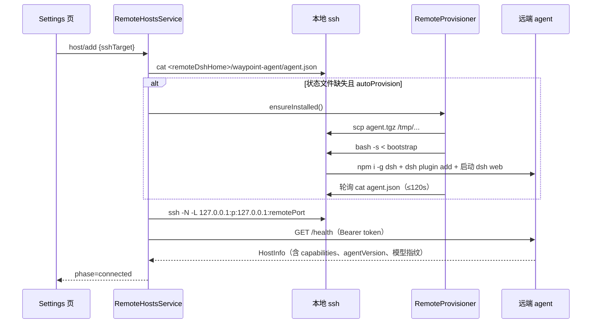

# 远程工作区是怎么打开的：一次连接、一个镜像、一条隧道

本文解释 `dsh-waypoint` 在运行时如何把「另一台机器上的目录」变成「本地侧边栏里的一个工作区」，
以及点击它之后为什么用的是**普通会话界面**而不是 iframe 或第二个聊天窗口。读者对象是第一次读这个
仓库、需要定位修改点或判断边界的开发者；协议字段的逐条定义在 [protocol.md](protocol.md)，运维动作在
[operations.md](operations.md)，本文不重复这两份文档的内容。

文中所有路径、符号与行号来自本次阅读的源码（提交 `1499dd1`），未执行的验证在最后一节单独说明。

## 1. 一句话机制与它避开的坑

本地 DSH 进程里同时存在四个东西：一个**主机注册表**、一条**SSH 隧道**、一个**本地 Session 镜像**、
一个挂在镜像 Session 上的**自定义 Agent 外观（façade）**。远端跑着一套完整的 `dsh web`，外加一个
`dsh-waypoint-agent` 插件提供的 HTTP/SSE 接口。左侧列表看到的是本地 Session，执行发生在远端。

```text
本地 DSH 进程                                       远端主机
┌───────────────────────────────────────┐          ┌──────────────────────────────┐
│ workspaceRegistry.create(anchor)      │          │ dsh web (127.0.0.1:随机端口) │
│ sessions.create(seed=远端事件日志)    │  ssh -L  │  └ dsh-waypoint-agent 路由   │
│ agents.enter(RemoteMirrorAgent)       │◀────────▶│     /dsh-waypoint-agent/api/v1│
│ HostsApi ── /api/dsh-waypoint ──┐     │          │                              │
│                                 ▼     │  ssh -R  │ 工作区/会话/PTY/文件读写     │
│ RemoteHostsService ── RemoteAgentClient ─────────▶│ 模型调用（直连或回本地代理） │
└───────────────────────────────────────┘          └──────────────────────────────┘
```

关键在于**没有第二套 UI，也没有第二套 agent loop**。远端 DSH 始终是执行归属方；本地 Session 只是远端
提交事件日志的持久投影（`packages/local-plugin/src/mirror/service.ts:1-13` 的模块注释把这一点写成设计约束）。
这样做的直接收益是：侧边栏、会话组装器、composer、工具卡片、停止按钮全部复用现成代码路径，插件只需要在
「Session 从哪来」「prompt 发到哪」「事件从哪读」三个接缝上做替换。

代价也在同一处：镜像必须自己维护「远端 seq ↔ 本地 seq」的映射，并且任何一条补不上的缺口都会让镜像停止
跟随（见第 5.5 节）。

## 2. 五个组件各自负责什么

| 包 | 运行时角色 | 入口 |
|---|---|---|
| `packages/local-plugin` | 主机注册表、隧道、凭据路径、镜像服务、`/api` 路由、Settings 页、工具 | `src/index.ts:34` 的 `apply` |
| `packages/remote-agent` | 装在远端 `web` profile 里的 DSH 插件，注册 loopback HTTP/SSE 路由 | `packages/remote-agent/src/index.ts:36` |
| `packages/protocol` | 路由表、信封校验、SSE 解析、typed client | `src/client.ts:149` `RemoteAgentClient` |
| `packages/installer` | 生成并执行远端 bootstrap 脚本（scp + `bash -s`） | `src/provision.ts:64` |
| `packages/terminal-controller` | profile fork：按 Session 决定终端走本地还是隧道 | `src/client/routing.js:8` |

本地插件的 `apply` 把所有部件按依赖顺序挂上：先建 `RemoteHostsService`（主机）与 `RemoteMirrorService`
（镜像），再 `mirrors.start()` → `service.start()` → `mirrors.sync()`，然后才注册 `/api` 路由、文件适配器、
终端路由与工具（`src/index.ts:36-64`）。顺序是有意的：镜像必须在第一次 host-store 读取或连接 await
之前就装好归属关系，否则启动瞬间的回放会把远端会话当成普通会话。

## 3. 首次连接：从 SSH 目标到 `connected`

### 3.1 时序



### 3.2 发现：只读一个文件

连接的第一件事不是开隧道，而是发现端点。`discoverAgent` 用 `execFile` 跑一条**固定**的 `cat` 命令读出
远端的私有状态文件，再按 `isAgentDiscoveryState` / `isAgentLive` 校验结构
（`packages/local-plugin/src/ssh/probe.ts:75-142`）。命令本身由 `discoveryCommand` 拼装，路径只来自插件
配置且经过引号转义（`probe.ts:43-57`）——扫描 SSH 配置和读取状态文件这两条路径都刻意不把用户输入拼进
shell 语法。

```ts
export async function discoverAgent(target, options): Promise<DiscoveryResult> {
  // ...
  if (!isAgentDiscoveryState(parsed)) throw new LocalError('agent/unavailable', 'remote agent state file has an unexpected shape', ...)
  if (!isAgentLive(parsed)) throw new LocalError('agent/unavailable',
    'remote agent is installed but its DSH web listener is not running; start `dsh web` on the remote host', ...)
```

状态文件由远端 agent 自己写：`#bindListener` 从 `ctx.webServer.port` 取真实端口，再原子写入
`0600` 文件（`packages/remote-agent/src/service.ts:765`、`src/state.ts:122`）。**agent 不监听自己的 TCP
端口**，它只是把路由注册到远端 DSH web server 上（`src/http.ts:46`），所以 `agent.json` 里的 `port`
就是那台 `dsh web` 的端口。插件端 `remoteStart: systemd` 生成的 unit 用 `--port 0` 让系统选端口，因此
每次重启端口都可能变，这也是状态文件里必须写端口、而插件必须每次连接都重新发现的原因。

### 3.3 装不出来就明说：bootstrap 的边界

`RemoteProvisioner.ensureInstalled` 把一个随插件打包的 `dsh-waypoint-agent-*.tgz` 上传到 `/tmp`，再以
stdin 方式执行渲染出来的 bash 脚本（`packages/installer/src/provision.ts:64-123`）。脚本做四件事：解析
账号真实 shell 找到 Node.js、把 `pnpm` 和 `@deepseek-ai/dsh` 装进 npm 全局前缀、`dsh plugin --profile web add`
那个 tarball、最后启动 `dsh web`（`packages/installer/src/bootstrap.ts:223-477`）。

两个刻意的「不做」比「做」更能解释设计：

- **不安装 Node.js**。版本管理器（nvm/fnm/Volta）只在登录/交互式 shell 里生效，非交互式 SSH 命令看到的
  `node` 可能完全不同。因此 `nodePathPrelude` 先问账号自己的 shell（`-lic`，缺失时退到 `-lc`），再把
  结果放到 `PATH` 前面（`bootstrap.ts:109-194`）；实在找不到就以 `exit 21` / `exit 22` 带着证据失败，
  由宿主卡上的「安装远端 Node.js」按钮承担这个决定。
- **不迁移安装位置**。全局前缀要么是配置值，要么是 `npm prefix -g` 的答案；没有第三个候选
  （`globalPrefixPrelude`，`bootstrap.ts:206-220`）。写不进去就按 npm 的错误失败，而不是悄悄装到别处。

失败按可恢复性分两类：瞬时失败交给指数退避重连，`install/node-missing`、`install/node-outdated`、
`install/npm-missing`、`install/profile-migrate-failed` 这类「重传一次也还是这个结果」的原因被记为
permanent，停止自动重试并保留原始报错（`packages/local-plugin/src/remote/provisioner.ts:296-308`、
`src/service.ts:974-987`）。

### 3.4 隧道：两条 `-L`/`-R` 决定流量方向

隧道只是一个 `ssh -N` 子进程，绑定 `127.0.0.1` 的临时端口并转发到远端 agent 端口：

```ts
return [
  ...baseSshArgs(...),                 // BatchMode, ConnectTimeout, StrictHostKeyChecking, keepalive
  '-N',
  '-o', 'ExitOnForwardFailure=yes',
  '-L', `127.0.0.1:${localPort}:127.0.0.1:${options.remotePort}`,
  ...options.reverseForward === undefined ? [] : [
    '-R', `127.0.0.1:${options.reverseForward.remotePort}:127.0.0.1:${options.reverseForward.localPort}`,
  ],
  options.target.destination,
]
```

（`packages/local-plugin/src/ssh/tunnel.ts:32-49`）

`-L` 是读路径：本地 `RemoteAgentClient` 打 `http://127.0.0.1:<localPort>` 就等于打远端 agent。`-R` 只在
「本地 Key 代理」模式出现（第 7 节）。`Tunnel.start` 会先向系统要一个空闲 loopback 端口，再等它真的能
建连，并且额外检查一次子进程是否还在——端口通了但 ssh 立刻退出，是「假就绪」最常见的样子
（`tunnel.ts:126-198`）。

隧道建立后 `#doConnect` 用健康检查收尾，并做两件「连上之后还要核对」的事：

- `#reconcileAgentVersion`：远端 agent 版本与本 build 打包的版本**不相等**（不是「更旧」）就重装一次。
  注释说明了原因：bundle 可以只改行为不改版本号，而「旧一点没关系」的假设正是让过期
  `cordis.patch.yml` 一直生效的原因（`src/service.ts:1079-1113`）。
- `#reconcileModelEnvironment`：把远端报告的 `modelBaseUrl` 与 `DEEPSEEK_API_KEY` 的 sha256 指纹和自己
  期望的值比较，不一致就重装一次（`src/service.ts:1115-1165`）。远端只回指纹，不回密钥本身
  （`packages/remote-agent/src/service.ts:178-183`）。

两处都用 `#agentReconciled` / `#modelReconciled` 限制成「每个连接周期一次」，避免健康检查心跳把重装
变成死循环。

## 4. 工作区：本地锚点 + 注册表记录

远端工作区不会「同步」到本地磁盘，插件只是在本地**注册一个空目录**当锚点，并记住它对应远端哪个路径：

```ts
const anchor = join(this.#config.stateDir, 'anchors', safe(host.id), safe(remote.workspaceId))
await mkdir(anchor, { recursive: true })
const title = `${host.label} · ${remote.title}`
const workspace = await this.#workspaceRegistry.create(anchor, title)
this.#state.workspaces[ref] = {
  hostId: host.id, remoteWorkspaceId: remote.workspaceId, localWorkspaceId: String(workspace.id),
  anchor, remoteRoot: remote.path, title, updatedAt: new Date().toISOString(),
}
```

（`packages/local-plugin/src/mirror/service.ts:1775-1787`）

这就是「远端工作区在侧边栏里像本地工作区」的全部魔法：`workspaceRegistry.create` 是原生的，标题带
`<host> · <title>` 前缀以便区分，`mirrors.json` 里额外存了 `remoteRoot`。锚点存在有两个后果，都很重要：

1. **本地是空目录**。任何直接用本地 `fs` 读锚点的代码都会看到空目录，所以文件树、预览、git 之类的路径
   必须被显式接管（第 6 节）。README 的「Known limits」把锚点描述为「metadata handle」，说的就是这件事。
2. **锚点同时也是镜像 Session 的 `cwd`**。本地 Session 需要一个路径，工具卡片里的相对路径也靠它对齐；
   远端绝对路径则通过 `remoteFileContext` 反查回 `hostId + remoteRoot`（`service.ts:750-760`）。

`sync()` 每隔 `max(5s, mirrorPollMs×4)` 跑一次，对每个 `connected` 主机调用 `#syncHost`：先列出远端
工作区并 `#ensureWorkspace`，再列出远端会话并 `#ensureMirror`（`service.ts:641-658`、`1602-1666`）。创建
路径本身是 check-then-act 且跨多个 await，所以按 `hostId:remoteSessionId` 做了 single-flight 合并，防止
周期 sync 与按需创建各建一个本地 Session（`service.ts:1949-1960`、`src/mirror/inflight.ts:15`）。

工作区身份由 `(hostId, remoteWorkspaceId)` 组合键确定；子代理会话、没有工作区归属的会话分别用父会话锚点
和 `ungrouped:<cwd hash>` 兜底（`service.ts:1812-1851`）。

## 5. 会话：把远端事件日志投影成一个本地 Session

### 5.1 三种「新建会话」入口，两种来源

| 入口 | 走哪条路 |
|---|---|
| 工作区行的 `+` / 全局新建（镜像工作区） | `client/routing.ts` 拦截 → `host/session/blank` → 本地空 Session + 懒 Agent |
| 工作区创建对话框 | `client/workspace-add.ts` → `host/workspace/create` → 等本地镜像 → `host/session/blank` |
| 远端已有会话 | `sync()` 发现 → `#ensureMirror` 直接建映射 |
| 原生新建一个会话，其 cwd 落在镜像锚点下 | `agent/pre-step` 拦截 → `#promoteNativeDraft` 提升为远端会话 |

第一、二种都是「**本地先空，首条 prompt 才建远端会话**」：`startBlankSession` 立刻用
`sessions.create` 造一个本地 Session，挂上 `LazyRemoteMirrorAgent`，远端 `POST /sessions` 直到第一次
`send/steer` 才发生（`service.ts:1202-1288`、`1392-1449`）。这样「点新建会话」是瞬时完成的，而不会因为
远端慢而卡住一个空界面。

第三种是「远端先有，本地补投影」——这正是「打开一个已存在的远程工作区」的场景。

### 5.2 播种：`sessions.create(seed)`

`#ensureMirrorOnce` 拿到远端快照后，把事件映射成本地 `SessionEvent` 数组一次性播种：

```ts
const seed = filtered.map((event, index) => toSeedEvent(event, index, seqMap))
session = this.#sessions.create(localId as SessionId, {
  ...seed.length === 0 ? {} : { seed },
  meta: { cwd: anchor, ...Number.isFinite(remoteCreatedAt) ? { createdAt: remoteCreatedAt } : {} },
})
```

（`service.ts:2077-2088`）

播种前有两处清理，都是为了让本地历史**可渲染**而不是「字段齐全」：

- `isMirrorNoise` 丢掉本地没有对应物的事件：`agent/inbox/spliced`、`compaction/*`，以及
  `source.kind !== 'user'` 的 `user/message`（远端注入的上下文、技能目录、压缩检查点）
  （`service.ts:2700-2714`）。把远端注入的合成长消息回放进本地 transcript，不但污染提示词，还可能因为
  消息过大卡住镜像。
- `toSeedEvent` / `remapRemoteEvent` 把「替换」类 `surfaceOp` 一律降级成 `append`
  （`service.ts:2755-2775`、`2678-2698`）。远端替换区间是按远端 seq 定义的，而镜像可能裁掉了前缀或
  省略了事件，照搬会让本地 surface 投影指向一个已经不存在的节点。

如果远端日志超过 `mirrorMaxEvents`（默认 2000），快照只有尾部且 `truncated=true`：镜像会从尾部里第一个
`turn/start` 开始、到最后一个 `turn/end` 结束来播种，保证本地历史从完整 turn 边界开始，更早的内容留在远端
UI 里（`service.ts:2004-2019`）。尾部窗口里没有 `turn/start` 时按原样播种，不额外裁剪。

### 5.3 自定义 Agent：`RemoteMirrorAgent`

本地 Session 必须有一个 Agent 才能在会话界面里工作。插件注册的是一个**外观**，只实现界面真正会调用的
那几个方法（`service.ts:271-349`）：

| 方法 | 行为 |
|---|---|
| `status` | 跟随镜像的 `running` 标记（由远端 `turn/start`、`turn/end` 驱动） |
| `cancel()` | 清空本地 inbox，然后 `POST /sessions/:id/cancel` |
| `whenIdle()` | 等 `running` 变 false |
| `send/followup` | 空闲时立即发；正在跑时进本地 inbox，等 `turn/end` 再发（队列语义） |
| `steer` | 直接以 `mode: 'steer'` 发出 |
| `model.current/select()` | 读/写本地 `model/selection` 事件，由事件桥转发给远端 |

`ctx.agents.enter(agent)` 把它挂进本地 Agent registry（`service.ts:2168`），于是 Session 控制器、侧边栏、
composer 全部按普通 Agent 对待它。`inject()` 是空实现——远端上下文注入还没进镜像协议。

### 5.4 往下发：prompt、模型、取消

`#sendPrompt` 是唯一把本地输入送到远端的出口（`service.ts:1036-1129`）：

1. 先按 `promptParts` 拆出文本/图片，图片走本地 attachments 服务读成 base64（`1145-1180`）；
2. 用远端模型目录检查当前 `provider/model` 是否可路由，不可路由就先剔除（`1003-1020`、`1064-1073`）；
3. `POST /sessions/:id/prompt`，带 `mode`、`selection`、`content`；
4. 若远端回 `session/model-unavailable`，**去掉 selection 重发一次**，并记住这个选择不可用
   （`1084-1110`、`2886-2889`）；
5. 成功后把本地那条乐观 user 消息追加进 Session，并记录它的 `localSeq`（`1113-1121`）。

第 5 步是「不出现重复气泡」的关键：远端回放的 `user/message` 会消费 `pendingUsers`，直接复用本地那条
消息的位置，而不是再追加一条（`appendRemoteEvent`，`service.ts:2716-2742`）。图片、模型选择、沙箱模式
也各有一条本地事件 → 远端调用的旁路（`#onLocalSessionEvent`，`2404-2431`）。

### 5.5 往上收：SSE 跟随、seq 映射与缺口

读路径同时有两条流，外加一条轮询：

| 通道 | 内容 | 用途 |
|---|---|---|
| `GET /sessions/:id/events?cursor=N` | 已提交的语义事件（SSE），首帧必 `ready` | 追加进本地 Session，驱动 turn 状态 |
| `GET /sessions/:id/assistant-events` | 进程内 dense token 帧 | 让本地界面在提交前就有流式输出 |
| `GET /sessions/:id?limit=N` | 最新一页 | 冷会话、断流修复、追赶 |

跟随逻辑是教科书式的游标推进（`service.ts:2313-2344`）：

```ts
if (event.seq < runtime.record.lastSeq) continue
if (event.seq !== runtime.record.lastSeq) {
  runtime.lastError = `remote event gap at ${event.seq}, mirror ${runtime.record.lastSeq}`
  return
}
this.#appendEvent(runtime, event)
runtime.record.lastSeq = event.seq + 1
```

缺口不是靠重试修补，而是**结束这条流**，把修复交给下一轮 `#poll` 的快照重放
（`#replaySnapshot`，`service.ts:2257-2276`）。同一套规则在远端也实现了一次
（`packages/remote-agent/src/stream.ts:34-126`），并且远端会先订阅再读长度，避免快照与订阅之间的窗口丢事件。

`#appendEvent` 维护三件事（`service.ts:2346-2402`）：本地 seq 映射表、`turn/start`/`turn/end` 驱动的
running 标记，以及「inbox 里的下一条 prompt 何时放行」。远端 turn 以 `aborted` 结束时清空 inbox，否则在
`turn/end` 后把下一条排队输入发出去。

还有两个「远端异常」的处理值得单独记住：

- **冷会话不能 follow**。远端 `assertCanFollow` 只接受内存里 live 的 Session（`agent/not-live`），
  所以镜像对已结束的会话只靠轮询追平，追平后停止（`service.ts:2225-2245`）。
- **远端中途重启会留下没有 `turn/end` 的 turn**。`#closeAbandonedTurn` 依据本地 `turnBoundary` 投影补一个
  `aborted/disposed` 的 `turn/end`，否则镜像永远认为自己在 running，之后每条 prompt 都进 inbox 且不再跟随
  （`service.ts:2283-2302`、`src/mirror/recovery.ts:13`）。

### 5.6 审批：走本地弹窗，但决定要回到远端

远端 agent 把 DSH 的 `approval/request` waterfall 以 `{ prepend: true }` 接住
（`packages/remote-agent/src/service.ts:397-445`）——必须前置，因为 `dsh-api-remotes` 也会监听同一个
waterfall，被它先接走的话本地就永远看不到这个确认框。问题以 `GET /approvals/events` 的 SSE 回放给本地，
本地再走一次自己的 `approval/request` waterfall，最后 `POST /approvals/answer`
（`service.ts:1853-1938`、`src/http.ts:551-575`）。

一个容易被误读的细节：**只有用户正看着那个会话时才弹**。插件用客户端每 500ms 一次的
`host/session/open/claim` 请求当可见性心跳（`client/index.tsx:43-63`），服务端维护 5 秒窗口
（`service.ts:46-47`、`763-778`）；不可见时请求先入队，等会话被打开再派发。这不是省事，而是避免一次重连
把十几个历史审批同时倒到界面上。

## 6. 文件与终端：两个「按 Session 决定出口」的适配器

### 6.1 文件

文件操作有两层拦截，因为浏览器侧和 Host 侧的调用点不同：

1. **Host 侧**：`installRemoteWorkspaceFiles` 包住 `workspaceFiles` 服务的 `read/readBytes/stat/list/changes`，
   用 `mirrors.remoteFileContext(workspaceRoot)` 判断这个 cwd 是否属于某个镜像工作区。属于就改成走
   `RemoteAgentClient` 的 `file.*` 接口，并把返回值的 `absolutePath` 换回本地锚点路径
   （`src/remote/files.ts:32-89`）。
2. **浏览器侧**：Host 生成的 Remote 方法在适配器安装前就已经绑定，所以 `client/remote-files.ts` 把
   `ctx.remote.workspaceFiles` 换成走 `host/files/*` 端点的代理，端点内部再调同一套 `workspaceFiles`
   （`client/remote-files.ts:24-51`、`host-api/handler.ts:303-334`）。
3. **路径换算**：`resolveRemoteFileTarget` 处理两个命名空间——远端绝对路径优先（让 transcript 链接和工具
   卡片继续可用），其后是锚点内的相对/绝对路径，最后才是「锚点外的远端绝对路径也放行给 agent」
   （`src/remote/remote-path.ts:57-110`）。这条规则是 Windows 客户端浏览 Linux 工作区的前提。

### 6.2 终端

终端比文件更麻烦：`ClientTerminals` 在客户端构造时就拿到了 `ctx.remote.terminal`，没有实例级替换点。
仓库的解法是一个**构建期 fork**：`packages/terminal-controller/scripts/build.mjs` 读取被 pin 的 stock
客户端产物，只替换模块 id 和 `apply` 函数，把 `routeTerminal` 那段拼进去，并校验产物里仍存在
`watch(`、`boundTerminal(`、`isRepresented(` 这些 0.2.2 形态的标记——形状变了就报错要求重新推导，而不是
静默产出错的东西（`build.mjs:18-53`）。

替换后的 provider 用一个「这个 Session 是不是镜像」的判断分流（`src/client/routing.js:14-53`）：是镜像
就调 `/api/dsh-waypoint-terminal`，不是就退回原实现。Host 侧再由 `installRemoteTerminalController` 把
gateway 的 `environment/shells/list/create/attach/rename/close/watch/retain` 按 Session 重定向到
`RemoteTerminals`（`src/remote/terminal-controller.ts:34-111`），后者通过隧道的 `/terminals/*` 操作远端
PTY（`src/remote/terminal.ts:32-175`）。远端 PTY 用 Python 标准库 `pty` 实现，避免依赖原生 node-pty 编译
（`packages/remote-agent/src/terminal.ts:60-120`）。

`retain` 特意返回一个「一直开着」的流：rc.2 的 `TerminalWindowHold` 把结束的 hold 流当成终端不可用。

## 7. 模型凭据：两条路径，按主机选择

默认是 **Remote direct**：本地解析出的 key 被写进远端 `dsh web` 的启动环境——systemd unit 里是
`Environment="DEEPSEEK_API_KEY=..."`（unit 文件 `chmod 600`），nohup 模式是行内环境变量
（`packages/installer/src/bootstrap.ts:64-90`、`510-524`）。远端直接打 `https://api.deepseek.com/anthropic`。

可选是 **Local key proxy**：远端只拿到每主机一个占位 token 和内网地址，隧道额外加 `-R`，本地
`ModelCredentialProxy` 校验 token、注入真实 key、转发到上游（`src/credentials/proxy.ts:41-145`、
`src/service.ts:1175-1283`）。代理是单个 loopback server，多个可以共用，靠每主机不同的 token 区分，因此
一台 direct 主机永远拿不到 proxy token，一台 proxy 主机永远拿不到真 key。

两条路径都靠第 3.4 节的 `#reconcileModelEnvironment` 保持一致，切换来源则直接复用 provisioning 流程
（远端进程必须带新环境重启）：`setModelSource` 只是存下选择再调 `provision`（`src/service.ts:408-425`）。

## 8. 版本、重连与降级边界

- **协议版本是硬门**：`PROTOCOL_VERSION = 1`，不匹配返回 `409 protocol/version-mismatch`，没有静默降级
  （`packages/protocol/src/version.ts:13-19`、`packages/remote-agent/src/http.ts:89-101`）。这与
  [protocol.md](protocol.md) 的「Version rules」一致。
- **agent 版本按「不等即换」**，见 3.4。**DSH 运行时版本只提示不阻断**：远端比本地旧时宿主卡出现
  「更新远端 DSH」，由用户决定（`src/version.ts:63-71`）。
- **重连有上限**：指数退避（1s 起、上限 `maxReconnectDelayMs`），超过 `provisionRetryLimit`（默认 3）就停在
  错误态等人处理；permanent 安装失败连退避都不进（`src/service.ts:1352-1388`）。
- **镜像记录会被回收**：本地 Session 已经不存在的映射会在 sync 时清掉，但「内存里全查不到」这种一次性
  全 miss 需要拿磁盘归档再确认一次，避免把未 hydrate 的注册表误判成「全部消失」
  （`src/mirror/service.ts:673-747`）。

## 9. 代价与已知限制

| 限制 | 直接原因 |
|---|---|
| 超过 `mirrorMaxEvents` 的远端会话只镜像尾部 | 快照是「最新一页」，更早历史仍在远端 UI |
| 冷会话没有事件流，只有轮询 | 远端 `session/not-live`，cold resume 未实现 |
| 锚点是空目录，本地直接读 `fs` 会看到空 | 远端内容从不落地到本地磁盘 |
| remote diff / 部分高级文件动作仍用本地工具的既有结果 | 只接管了 `workspaceFiles` 与终端两个接缝 |
| 需要 SSH 可达，无 relay/NAT 穿透 | 当前只有 ssh `-L`/`-R` |
| Windows 远端不支持 | bootstrap 是 POSIX bash，Node.js 也按 Linux/macOS 处理 |

## 10. 想动手改，从哪里进

| 想改的行为 | 入口 |
|---|---|
| 连接阶段/重试/凭据路径 | `packages/local-plugin/src/service.ts`（`#doConnect:905`、`#modelPathFor:1175`） |
| 远端安装流程 | `packages/installer/src/bootstrap.ts` + `src/provision.ts` |
| 工作区/会话映射与同步 | `packages/local-plugin/src/mirror/service.ts`（`sync:641`、`#syncHost:1602`、`#ensureMirrorOnce:1962`） |
| 本地 prompt → 远端 | `#sendPrompt:1036`、`RemoteMirrorAgent:271` |
| 远端事件 → 本地 Session | `#appendEvent:2346`、`toSeedEvent:2755`、`isMirrorNoise:2700` |
| 新增远端能力 | `packages/protocol/src/routes.ts` + `packages/remote-agent/src/http.ts` + `RemoteAgentClient` |
| 文件/终端路由 | `src/remote/files.ts`、`src/remote/terminal-controller.ts`、`packages/terminal-controller/scripts/build.mjs` |
| Settings 页行为 | `src/client/RemoteDevelopmentPanel.tsx` + `src/host-api/handler.ts` |

## 11. 验证状态

本文是对源码的静态阅读结果：所有符号、行号与行为描述都对应上面引用的文件。**没有**运行 `pnpm test`
或 `pnpm typecheck`，也没有连接真实远端主机复现时序；第 3.1 节的时序图是按代码路径整理，未做图形渲染
验证。若要确认某条结论，最小的复现路径是 `./scripts/test-sandbox.sh` 起隔离环境，再按
[docs/testing.md](testing.md) 的可见性约定跑一次集成用例。
