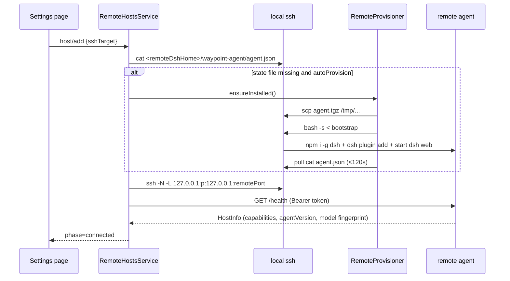

# How a remote workspace opens: one connection, one mirror, one tunnel

This page explains how `dsh-waypoint` turns "a directory on another machine" into "a workspace in the
local sidebar" at runtime, and why clicking it opens the **ordinary conversation UI** instead of an
iframe or a second chat window. It is written for someone reading this repository for the first time
who needs to find the place to change or to judge the boundaries. Per-field protocol definitions live
in [protocol.md](protocol.md) and operator actions in [operations.md](operations.md); this page does
not repeat either.

Source locations are cited as `file → symbol` rather than line numbers: line numbers drift with every
refactor while symbol names stay searchable. The behaviour described corresponds to plugin `1.0.1`.

## 1. The mechanism in one sentence, and the traps it avoids

Four things live in the local DSH process at once: a **host registry**, an **SSH tunnel**, a **local
session mirror**, and a **custom Agent façade** mounted on the mirrored session. The remote side runs a
complete `dsh web` plus an HTTP/SSE interface provided by the `dsh-waypoint-agent` plugin. The sidebar
shows a local session; execution happens remotely.

```text
local DSH process                                    remote host
┌───────────────────────────────────────┐          ┌──────────────────────────────┐
│ workspaceRegistry.create(anchor)      │          │ dsh web (127.0.0.1:random)   │
│ sessions.create(seed=remote event log)│  ssh -L  │  └ dsh-waypoint-agent routes │
│ agents.enter(RemoteMirrorAgent)       │◀────────▶│     /dsh-waypoint-agent/api/v1│
│ HostsApi ── /api/dsh-waypoint ──┐     │          │                              │
│                                 ▼     │  ssh -R  │ workspaces/sessions/PTY/files│
│ RemoteHostsService ── RemoteAgentClient ─────────▶│ model calls (direct or proxy)│
└───────────────────────────────────────┘          └──────────────────────────────┘
```

The point is that there is **no second UI and no second agent loop**. The remote DSH stays the owner of
execution; the local session is only a durable projection of the remote's committed event log (the
module comment in `packages/local-plugin/src/mirror/service.ts` states this as a design constraint).
The direct payoff: the sidebar, session assembler, composer, tool cards, and stop button all reuse
existing code paths, and the plugin only replaces three seams — where a session comes from, where a
prompt goes, and where events are read from.

The cost sits in the same place: the mirror has to maintain its own "remote seq ↔ local seq" mapping,
and any gap it cannot bridge stops the mirror from following (see §5.5).

## 2. What each of the five packages owns

| Package | Runtime role | Entry point |
|---|---|---|
| `packages/local-plugin` | Host registry, tunnel, credential paths, mirror service, `/api` routes, Settings page, tools | `apply` in `src/index.ts` |
| `packages/remote-agent` | DSH plugin installed into the remote `web` profile; registers loopback HTTP/SSE routes | `apply` in `packages/remote-agent/src/index.ts` |
| `packages/protocol` | Route table, envelope validation, SSE parsing, typed client | `RemoteAgentClient` in `src/client.ts` |
| `packages/installer` | Renders and runs the remote bootstrap script (scp + `bash -s`) | `provisionRemoteAgent` in `src/provision.ts` |
| `packages/terminal-controller` | Profile fork: decides per session whether the terminal is local or tunneled | `applyRouted` in `src/client/routing.js` |

The local plugin's `apply` mounts everything in dependency order: it builds `RemoteHostsService` (hosts)
and `RemoteMirrorService` (mirror), then `mirrors.start()` → `service.start()` → `mirrors.sync()`, and
only after that registers the `/api` routes, the file adapter, the terminal routes, and the tools
(`apply` in `src/index.ts`). The order is deliberate: the mirror must own its relationships before the
first host-store read or connection await, otherwise the replay at startup would treat remote sessions
as ordinary sessions.

## 3. The first connection: from an SSH destination to `connected`

### 3.1 Sequence



### 3.2 Discovery: read exactly one file

The first step of a connection is not the tunnel but endpoint discovery. `discoverAgent` runs one
**fixed** `cat` command through `execFile` to read the remote private state file, then validates its
shape with `isAgentDiscoveryState` / `isAgentLive` (`discoverAgent` in
`packages/local-plugin/src/ssh/probe.ts`). The command itself is assembled by `discoveryCommand`, and
the path comes only from plugin configuration and is quote-escaped (`discoveryCommand` in the same
file) — neither SSH-config scanning nor the state-file read ever splices user input into shell syntax.

```ts
export async function discoverAgent(target, options): Promise<DiscoveryResult> {
  // ...
  if (!isAgentDiscoveryState(parsed)) throw new LocalError('agent/unavailable', 'remote agent state file has an unexpected shape', ...)
  if (!isAgentLive(parsed)) throw new LocalError('agent/unavailable',
    'remote agent is installed but its DSH web listener is not running; start `dsh web` on the remote host', ...)
}
```

The remote agent writes the state file itself: `#bindListener` takes the real port from
`ctx.webServer.port` and then writes a `0600` file atomically (`#bindListener` in
`packages/remote-agent/src/service.ts`, `writeState` in `src/state.ts`). **The agent does not listen on
a TCP port of its own**; it registers its routes on the remote DSH web server (`registerAgentRoutes` in
`src/http.ts`), so the `port` in `agent.json` is the port of that `dsh web`. The plugin side's
`remoteStart: systemd` unit passes `--port 0` and lets the OS choose (the default in
`packages/installer/src/options.ts`), so the port can change on every restart — which is why the state
file has to record it and why the plugin has to rediscover on every connection.

### 3.3 When it cannot install, it says so: the bootstrap boundary

`RemoteProvisioner.ensureInstalled` uploads the bundled `dsh-waypoint-agent-*.tgz` to `/tmp` and then
runs the rendered bash script through stdin (`provisionRemoteAgent` in
`packages/installer/src/provision.ts`). The script does four things: resolve the account's real shell to
find Node.js, install `pnpm` and `@deepseek-ai/dsh` into the npm global prefix, `dsh plugin --profile
web add` that tarball, and finally start `dsh web` (`renderBootstrapScript` in
`packages/installer/src/bootstrap.ts`).

Two deliberate "we do not" decisions explain the design better than the "we do" list:

- **We do not install a runtime.** Version managers (nvm/fnm/Volta) only take effect in login or
  interactive shells, so the `node` a non-interactive SSH command sees can be entirely different. So
  `nodePathPrelude` asks the account's own shell first (`-lic`, falling back to `-lc`) and puts the
  result at the front of `PATH` (`nodePathPrelude` in the same file); when nothing is found it fails
  with `exit 21` / `exit 22` plus the evidence, and the host card's **install remote Node.js** action
  owns that decision.
- **We do not relocate the install.** The global prefix is either the configured value or whatever
  `npm prefix -g` answers; there is no third candidate (`globalPrefixPrelude` in the same file). If it
  is not writable the install fails with npm's own error instead of quietly installing somewhere else.

Failures split by recoverability: transient ones go to exponential-backoff reconnect, while reasons
that would produce the same result on a retry — `install/node-missing`, `install/node-outdated`,
`install/npm-missing`, `install/profile-migrate-failed` — are recorded as permanent, stop automatic
retries, and keep the original error (`PERMANENT_INSTALL_CODES` in
`packages/local-plugin/src/remote/provisioner.ts`, the failure branch of `#doConnect` in
`src/service.ts`).

### 3.4 The tunnel: two `-L`/`-R` forwards decide the traffic direction

The tunnel is just an `ssh -N` child process bound to an ephemeral port on `127.0.0.1`, forwarding to
the remote agent port:

```ts
return [
  ...baseSshArgs(...),                 // BatchMode, ConnectTimeout, StrictHostKeyChecking, keepalive
  '-N',
  '-o', 'ExitOnForwardFailure=yes',
  '-L', `127.0.0.1:${localPort}:127.0.0.1:${options.remotePort}`,
  ...options.reverseForward === undefined ? [] : [
    '-R', `127.0.0.1:${options.reverseForward.remotePort}:127.0.0.1:${options.reverseForward.localPort}`,
  ],
  options.target.destination,
]
```

(`tunnelArgs` in `packages/local-plugin/src/ssh/tunnel.ts`)

`-L` is the read path: hitting `http://127.0.0.1:<localPort>` from the local `RemoteAgentClient` is
hitting the remote agent. `-R` appears only in local-key-proxy mode (§7). `Tunnel.start` first asks the
system for a free loopback port, then waits until it can actually connect, and additionally checks once
more that the child process is still alive — a port that accepts but whose `ssh` exited immediately is
the most common shape of a false "ready" (`Tunnel.start` in `src/ssh/tunnel.ts`).

Once the tunnel is up, `#doConnect` finishes with a health check and then does two things that only
matter after connecting:

- `#reconcileAgentVersion`: if the remote agent version is **not equal** to the version this build
  bundles (not "older"), reinstall once. The comment explains why: a bundle can change behaviour
  without changing its version, and the "a bit older is fine" assumption is exactly what keeps a stale
  `cordis.patch.yml` in effect (`#reconcileAgentVersion` in `src/service.ts`).
- `#reconcileModelEnvironment`: compares the remote-reported `modelBaseUrl` and the sha256 fingerprint
  of `DEEPSEEK_API_KEY` against the expected values and reinstalls once on a mismatch
  (`#reconcileModelEnvironment` in `src/service.ts`). The remote only returns the fingerprint, never
  the key itself (`hostInfo` in `packages/remote-agent/src/service.ts`).

Both are limited to once per connection cycle by `#agentReconciled` / `#modelReconciled`, so a health
check heartbeat cannot turn the reconciliation into a reinstall loop.

## 4. Workspaces: a local anchor plus a registry record

A remote workspace is not "synced" to local disk. The plugin registers an **empty local directory** as
an anchor and remembers which remote path it stands for:

```ts
const anchor = join(this.#config.stateDir, 'anchors', safe(host.id), safe(remote.workspaceId))
await mkdir(anchor, { recursive: true })
const title = `${host.label} · ${remote.title}`
const workspace = await this.#workspaceRegistry.create(anchor, title)
this.#state.workspaces[ref] = {
  hostId: host.id, remoteWorkspaceId: remote.workspaceId, localWorkspaceId: String(workspace.id),
  anchor, remoteRoot: remote.path, title, updatedAt: new Date().toISOString(),
}
```

(`#ensureWorkspace` in `packages/local-plugin/src/mirror/service.ts`)

That is the whole magic behind "a remote workspace behaves like a local one in the sidebar":
`workspaceRegistry.create` is native, the title carries a `<host> · <title>` prefix so rows stay
distinguishable, and `mirrors.json` stores `remoteRoot` alongside. The anchor has two consequences,
both important:

1. **It is empty locally.** Any code that reads the anchor with plain `fs` sees an empty directory, so
   the file tree, previews, git, and similar paths have to be intercepted explicitly (§6). The README's
   "Known limits" calls the anchor a metadata handle for exactly this reason.
2. **It is also the mirrored session's `cwd`.** A local session needs a path, and relative paths in
   tool cards are aligned against it; a remote absolute path is mapped back to `hostId + remoteRoot`
   through `remoteFileContext` (`remoteFileContext` in `src/mirror/service.ts`).

`sync()` runs every `max(5s, mirrorPollMs×4)` and calls `#syncHost` for each `connected` host: list the
remote workspaces and `#ensureWorkspace` them, then list the remote sessions and `#ensureMirror` them
(`sync` and `#syncHost` in `service.ts`). Creation is check-then-act across several awaits, so it is
coalesced per `hostId:remoteSessionId` with a single-flight table — otherwise the periodic sync and an
on-demand creation would each build their own local session (`#ensureMirror`, `singleFlight` in
`src/mirror/inflight.ts`).

Workspace identity is the `(hostId, remoteWorkspaceId)` pair; subagent sessions and sessions with no
workspace fall back to the parent session's anchor and to `ungrouped:<cwd hash>` respectively
(`#ensureUngroupedWorkspace`).

## 5. Sessions: projecting the remote event log into a local session

### 5.1 Three "new session" entries, two origins

| Entry | Path taken |
|---|---|
| Workspace row's `+` / global New Session (mirrored workspace) | `client/routing.ts` intercepts → `host/session/blank` → empty local session + lazy Agent |
| Workspace creation dialog | `client/workspace-add.ts` → `host/workspace/create` → wait for the local mirror → `host/session/blank` |
| Session that already exists remotely | `sync()` discovers it → `#ensureMirror` builds the mapping directly |
| A native new session whose cwd falls under a mirror anchor | `agent/pre-step` intercepts → `#promoteNativeDraft` promotes it to a remote session |

The first two are "**local first, remote on the first prompt**": `startBlankSession` immediately creates
a local session with `sessions.create`, mounts `LazyRemoteMirrorAgent`, and the remote `POST /sessions`
only happens on the first `send/steer` (`startBlankSession`, `#materializeBlankOnce`). That makes "new
session" instantaneous instead of parking an empty UI on a slow remote.

The third is "remote first, local projection added" — which is exactly the "open an existing remote
workspace" case.

### 5.2 Seeding: `sessions.create(seed)`

After `#ensureMirrorOnce` obtains the remote snapshot, it maps the events into a local `SessionEvent`
array and seeds in one go:

```ts
const seed = filtered.map((event, index) => toSeedEvent(event, index, seqMap))
session = this.#sessions.create(localId as SessionId, {
  ...seed.length === 0 ? {} : { seed },
  meta: { cwd: anchor, ...Number.isFinite(remoteCreatedAt) ? { createdAt: remoteCreatedAt } : {} },
})
```

(`#ensureMirrorOnce` in `service.ts`)

Two filters run before seeding, both so the local history is **renderable** rather than merely
"complete":

- `isMirrorNoise` drops events that have no local counterpart: `agent/inbox/spliced`, `compaction/*`,
  and `user/message` events whose `source.kind !== 'user'` (remote-injected context, skill catalogs,
  compaction checkpoints) (`isMirrorNoise` in `service.ts`). Replaying a remote-injected synthetic
  message into the local transcript both pollutes prompts and can stall the mirror on oversized
  messages.
- `toSeedEvent` / `remapRemoteEvent` downgrade every replacement-style `surfaceOp` to `append`
  (`toSeedEvent`, `remapRemoteEvent` in `service.ts`). A remote replacement range is defined in remote
  seq space, and the mirror may have trimmed a prefix or omitted events, so replaying it verbatim would
  point the local surface projection at a node that no longer exists.

When the remote log exceeds `mirrorMaxEvents` (default 2000) the snapshot holds only the tail with
`truncated=true`: the mirror seeds from the first `turn/start` in that tail to the last `turn/end`, so
local history starts on a complete turn boundary and the earlier content stays in the remote UI (the
truncated branch of `#ensureMirrorOnce`). If the tail contains no `turn/start` it seeds as-is with no
extra trimming.

### 5.3 The custom Agent: `RemoteMirrorAgent`

A local session needs an Agent to work in the conversation UI. The plugin registers a **façade** that
implements only the methods the UI actually calls (`RemoteMirrorAgent` in `service.ts`):

| Method | Behaviour |
|---|---|
| `status` | Follows the mirror's `running` flag (driven by remote `turn/start` / `turn/end`) |
| `cancel()` | Clears the local inbox, then `POST /sessions/:id/cancel` |
| `whenIdle()` | Waits for `running` to become false |
| `send/followup` | Sends immediately when idle; while running it queues into the local inbox and flushes on `turn/end` |
| `steer` | Sends immediately with `mode: 'steer'` |
| `model.current/select()` | Reads/writes the local `model/selection` event; the event bridge forwards it remotely |

`ctx.agents.enter(agent)` registers it in the local Agent registry (`#mountRuntime`), so the session
controller, sidebar, and composer treat it as an ordinary Agent. `inject()` is an empty implementation —
remote context injection is not part of the mirror protocol yet.

### 5.4 Downward: prompts, model, cancel

`#sendPrompt` is the single exit that carries local input to the remote (`#sendPrompt` in `service.ts`):

1. Split text and images with `promptParts`; images are read through the local attachments service as
   base64 (`#promptContent`).
2. Check the current `provider/model` against the remote model catalog and drop the selection first if
   it is not routable (`#selectionUnavailable`).
3. `POST /sessions/:id/prompt` with `mode`, `selection`, and `content`.
4. If the remote answers `session/model-unavailable`, **resend once without the selection** and
   remember that choice as unusable (the retry branch of `#sendPrompt`, `isSelectionRejection`).
5. On success, append the optimistic local user message to the session and record its `localSeq` (the
   tail of `#sendPrompt`).

Step 5 is what prevents a duplicated bubble: the replayed remote `user/message` consumes `pendingUsers`
and reuses the position of that local message instead of appending another (`appendRemoteEvent`).
Images, model selection, and sandbox mode each have their own local-event → remote-call bypass as well
(`#onLocalSessionEvent`).

### 5.5 Upward: SSE following, seq mapping, and gaps

The read path has two streams at once plus one poll:

| Channel | Content | Purpose |
|---|---|---|
| `GET /sessions/:id/events?cursor=N` | Committed semantic events (SSE), first frame always `ready` | Appends into the local session, drives turn state |
| `GET /sessions/:id/assistant-events` | In-process dense token frames | Gives the local UI streaming output before commit |
| `GET /sessions/:id?limit=N` | Newest page | Cold sessions, stream repair, catch-up |

Following is textbook cursor advancement (`#followStream`):

```ts
if (event.seq < runtime.record.lastSeq) continue
if (event.seq !== runtime.record.lastSeq) {
  runtime.lastError = `remote event gap at ${event.seq}, mirror ${runtime.record.lastSeq}`
  return
}
this.#appendEvent(runtime, event)
runtime.record.lastSeq = event.seq + 1
```

A gap is not repaired by retrying; the stream **ends** and repair is handed to the next `#poll`'s
snapshot replay (`#replaySnapshot`). The same rule is implemented once on the remote side too
(`followLiveSession` in `packages/remote-agent/src/stream.ts`), where it subscribes before reading the
length so nothing appended in the window between snapshot and subscription is lost.

`#appendEvent` maintains three things (`#appendEvent` in `service.ts`): the local seq mapping table, the
running flag driven by `turn/start`/`turn/end`, and when the next queued prompt in the inbox is
released. A remote turn that ends as `aborted` clears the inbox; otherwise the next queued input is sent
after `turn/end`.

Two remote-failure cases are worth remembering separately:

- **A cold session cannot be followed.** The remote `assertCanFollow` only accepts a session that is
  live in memory (`agent/not-live`), so the mirror catches up on a finished session by polling only and
  stops once it is caught up (`#poll`).
- **A remote restart mid-turn leaves a turn with no `turn/end`.** `#closeAbandonedTurn` synthesizes an
  `aborted/disposed` `turn/end` from the local `turnBoundary` projection; without it the mirror would
  believe it is running forever, and every later prompt would queue into the inbox without following
  again (`#closeAbandonedTurn` in `service.ts`, `abandonedTurnEnd` in `src/mirror/recovery.ts`).

### 5.6 Approvals: the prompt is local, the decision goes back

The remote agent catches DSH's `approval/request` waterfall with `{ prepend: true }`
(`#bindApprovals` in `packages/remote-agent/src/service.ts`) — it must prepend, because
`dsh-api-remotes` listens to the same waterfall and would otherwise claim the decision, leaving the
local UI never seeing the confirmation. The request is replayed to the local side as SSE on
`GET /approvals/events`, where it runs through the local `approval/request` waterfall again, and finally
`POST /approvals/answer` (`#ensureApprovalStream` in `service.ts`, `streamApprovals` in
`packages/remote-agent/src/http.ts`).

One easily misread detail: **it only prompts while the user is looking at that session.** The plugin
uses the client's 500 ms `host/session/open/claim` request as a visibility heartbeat (the poll in
`apply` in `packages/local-plugin/src/client/index.tsx`), and the server keeps a 5-second window
(`VISIBLE_SESSION_TTL_MS`, `reportVisibleSession` in `service.ts`); while the session is not visible the
request is queued and dispatched once it is opened. This is not laziness — it avoids dumping a dozen
historical approvals onto the screen after one reconnect.

## 6. Files and terminals: two adapters that pick an outlet per session

### 6.1 Files

File operations are intercepted at two layers, because the call sites on the browser side and the host
side differ:

1. **Host side**: `installRemoteWorkspaceFiles` wraps `read/readBytes/stat/list/changes` on the
   `workspaceFiles` service and uses `mirrors.remoteFileContext(workspaceRoot)` to decide whether that
   cwd belongs to a mirrored workspace. If it does, the call is redirected to the `RemoteAgentClient`
   `file.*` methods and the returned `absolutePath` is mapped back to the local anchor
   (`installRemoteWorkspaceFiles` in `src/remote/files.ts`).
2. **Browser side**: the Host-generated Remote methods are bound before an adapter can replace them, so
   `client/remote-files.ts` replaces `ctx.remote.workspaceFiles` with a proxy that calls the
   `host/files/*` endpoints, which in turn call the same `workspaceFiles`
   (`installRemoteFiles` in `src/client/remote-files.ts`, the `host/files/*` branch in
   `host-api/handler.ts`).
3. **Path translation**: `resolveRemoteFileTarget` handles two namespaces — a remote absolute path wins
   (so transcript links and tool cards keep working), then relative or absolute paths inside the anchor,
   and finally a remote absolute path outside the anchor is still allowed through to the agent
   (`resolveRemoteFileTarget` in `src/remote/remote-path.ts`). This rule is what lets a Windows client
   browse a Linux workspace.

### 6.2 The native file panel, and why one interception layer is enough

The Host ships its own right-sidebar file panel (`@deepseek-ai/dsh-client-ui-sidebar-files`, the
**Workspace files** page). It reads a Session's tree through `remote.workspaceFiles.list(sessionId,
path)`, previews through `read`/`stat`/`readBytes`, searches through `search`, and follows external
changes through `changes` — never through `node:fs`. Because a mirrored Session's cwd is the **empty
local anchor**, that panel would show an empty tree; §6.1's adapter is what makes it browse the remote
workspace instead. No third-party sidebar plugin takes part.

The mechanism is worth stating precisely, because a plausible reading of the code suggests the
opposite and once led this repository to ship a redundant browser-side proxy:

**The Host's Typert Gateway resolves a Remote method per call, not once at mount time.**

```ts
// prepareInvocation
const method = Reflect.get(callReceiver, implementation)
if (typeof method !== 'function') throw new TypertGatewayError('gateway/method-unavailable', …)
// invokePrepared
return await Reflect.apply(prepared.method, prepared.receiver, prepared.args)
```

`callReceiver` is the service instance, and `installRemoteWorkspaceFiles` installs its
implementations as **own properties of that instance**, shadowing the prototype for every caller in
the process. The browser's generated Remote methods, the native sidebar tree and the document preview
therefore all reach the adapter, whether or not anything is patched in the browser.

A browser-side proxy cannot observe that resolution, so it can only add a second interception point —
and it is a *wrong* one: forwarding the wire JSON hands `readBytes` callers the base64 **string** where
`WorkspaceFileBytes.data` is contractually a `Uint8Array`. The adapter decodes base64 into a `Buffer`,
and leaving the call on the generated path lets Typert's codec encode that Buffer correctly.

Three consequences the reader should know:

- **There is exactly one layer to maintain.** `read`, `readBytes`, `stat`, `list`, `search` and
  `changes` are all replaced there; a new capability is one more assignment, not a second plumbing
  path through the browser.
- **A renamed Host method is a silent failure, so it is checked and reported.** `remote/patch-contract.ts`
  compares the live service against `REQUIRED_WORKSPACE_FILE_METHODS` at install time; a missing name
  logs the exact method and sets `fileRouting: 'bypassed'` in the state the Settings page reads, so the
  symptom is "routing is off" rather than "the remote directory is empty".
- **The replacement is reversible.** The installer returns a restorer that runs inside `ctx.effect`;
  it deletes only the own properties it created, so the prototype method becomes visible again and a
  replacement installed by a later plugin is left alone.

The panel is read-only in this release: it offers no upload, edit, rename or delete, because writing
into the anchor would create a second authority for bytes the remote already owns.

### 6.3 Terminals

Terminals are harder than files: `ClientTerminals` receives `ctx.remote.terminal` when the client is
constructed, and there is no per-instance replacement point. The repository's answer is a **build-time
fork**: `packages/terminal-controller/scripts/build.mjs` reads the pinned stock client artifact,
replaces only the module id and the `apply` function, splices the `routeTerminal` block in, and verifies
that the artifact still contains the `watch(`, `boundTerminal(`, and `isRepresented(` markers of the
0.2.2 shape — if the shape changed it errors and asks for a re-derivation instead of silently emitting
something wrong (the stock-artifact check in `scripts/build.mjs`).

The replaced provider splits on an "is this session mirrored" check (`routeTerminal` in
`src/client/routing.js`): mirrored sessions call `/api/dsh-waypoint-terminal`, everything else falls back
to the original implementation. On the host side `installRemoteTerminalController` redirects the
gateway's `environment/shells/list/create/attach/rename/close/watch/retain` per session to
`RemoteTerminals` (`installRemoteTerminalController` in `src/remote/terminal-controller.ts`), which
drives the remote PTY over the tunnel's `/terminals/*` (`RemoteTerminals` in `src/remote/terminal.ts`).
The remote PTY is implemented with Python's standard-library `pty` (`PTY_HELPER` in
`packages/remote-agent/src/terminal.ts`) so it does not depend on a native node-pty build. That carries a
precondition: the remote host needs `python3`. Without it, installing and sessions still work and only
**New terminal** fails.

`retain` deliberately returns a stream that stays open: rc.2's `TerminalWindowHold` treats a finished hold
stream as "terminal unavailable".

## 7. Model credentials: two paths, chosen per host

The default is **Remote direct**: the locally resolved key is written into the remote `dsh web` launch
environment — an `Environment="DEEPSEEK_API_KEY=..."` line in the systemd unit (written `chmod 600`), or
an inline environment variable under nohup (`renderSystemdUnit`, `renderNohup` in
`packages/installer/src/bootstrap.ts`). The remote then calls
`https://api.deepseek.com/anthropic` directly.

The optional path is the **Local key proxy**: the remote only receives a per-host placeholder token and
an internal address, the tunnel adds `-R`, and the local `ModelCredentialProxy` validates the token,
injects the real key, and forwards upstream (`ModelCredentialProxy` in `src/credentials/proxy.ts`,
`#modelPathFor` in `src/service.ts`). The proxy is a single loopback server that many hosts can share,
distinguished by per-host tokens, so a direct host never receives a proxy token and a proxy host never
receives the real key.

Both paths are kept consistent by `#reconcileModelEnvironment` from §3.4, and switching sources reuses
the provisioning flow directly (the remote process has to restart with the new environment):
`setModelSource` only stores the choice and calls `provision` (`setModelSource` in `src/service.ts`).

## 8. Versions, reconnects, and degradation boundaries

- **The protocol version is a hard gate**: `PROTOCOL_VERSION = 1`, and a mismatch returns
  `409 protocol/version-mismatch` with no silent downgrade (`PROTOCOL_VERSION` in
  `packages/protocol/src/version.ts`, the negotiation block in `packages/remote-agent/src/http.ts`). This
  matches "Version rules" in [protocol.md](protocol.md).
- **The agent version is "different means replace"**, see §3.4. **The DSH runtime version only warns**:
  when the remote is older the host card offers **update remote DSH** and the user decides
  (`dshUpdateFor` in `src/version.ts`).
- **Reconnects are bounded**: exponential backoff (from 1 s up to `maxReconnectDelayMs`), and after
  `provisionRetryLimit` (default 3) attempts the host stops in an error state and waits for a person; a
  permanent install failure does not even enter backoff (`#scheduleReconnect` in `src/service.ts`).
- **Mirror records are collected**: mappings whose local session no longer exists are dropped during
  sync, but a one-off all-miss pass is confirmed against the on-disk archive first, so a not-yet-hydrated
  registry is not mistaken for "everything disappeared" (`#pruneDetachedSessions` in
  `src/mirror/service.ts`).

## 9. Costs and known limits

| Limit | Direct cause |
|---|---|
| Remote sessions over `mirrorMaxEvents` mirror only the tail | The snapshot is "the newest page"; earlier history stays in the remote UI |
| Cold sessions have no event stream, only polling | The remote answers `session/not-live`; cold resume is not implemented |
| The anchor is empty, so reading `fs` locally sees nothing | Remote content never lands on local disk |
| A renamed `workspaceFiles` method would silently switch file routing off | The install step checks the live service and reports `fileRouting: 'bypassed'` (6.2) |
| Remote diffs / some advanced file actions still use the native tool results | Only `workspaceFiles` and the terminal are intercepted |
| SSH reachability required; no relay/NAT traversal | Only ssh `-L`/`-R` today |
| Windows remotes unsupported | The bootstrap is POSIX bash, and Node.js is handled as Linux/macOS |
| The remote terminal needs `python3` | The PTY is a Python standard-library `pty` helper, not a native node-pty build |

## 10. Where to start when you want to change something

| Behaviour you want to change | Entry point |
|---|---|
| Connection phases, retry, credential path | `packages/local-plugin/src/service.ts` (`#doConnect`, `#modelPathFor`) |
| Remote installation flow | `packages/installer/src/bootstrap.ts` + `src/provision.ts` |
| Workspace/session mapping and sync | `packages/local-plugin/src/mirror/service.ts` (`sync`, `#syncHost`, `#ensureMirrorOnce`) |
| Local prompt → remote | `#sendPrompt`, `RemoteMirrorAgent` |
| Remote events → local session | `#appendEvent`, `toSeedEvent`, `isMirrorNoise` |
| Adding a remote capability | `packages/protocol/src/routes.ts` + `packages/remote-agent/src/http.ts` + `RemoteAgentClient` |
| File/terminal routing | `src/remote/files.ts`, `src/remote/terminal-controller.ts`, `packages/terminal-controller/scripts/build.mjs` |
| Settings page behaviour | `src/client/RemoteDevelopmentPanel.tsx` + `src/host-api/handler.ts` |

## 11. Verification status

**Checked statically** (read against the source of `1.0.1`, item by item):

- every `file → symbol` reference in this page resolves to exactly one definition;
- the code excerpts quoted in §3.2, §3.4, §5.2, and §5.5 match the source;
- the configuration defaults referenced here (`mirrorMaxEvents`, `mirrorPollMs`, `maxReconnectDelayMs`,
  `provisionRetryLimit`) match the schema defaults in `src/config.ts`.

**Not checked**:

- `pnpm test` and `pnpm typecheck` were not run for this page: it introduces no executable artifact and
  the change is documentation only;
- no live remote host was connected, so the ordering, timeouts, and sequencing are read from the code
  paths rather than observed;
- the mermaid sequence diagram in §3.1 is hand-written and has not been rendered.

To confirm any single claim the smallest reproduction is `./scripts/test-sandbox.sh`, which builds and
installs into an isolated environment, followed by one integration run under the visibility rules in
[docs/testing.md](testing.md).
